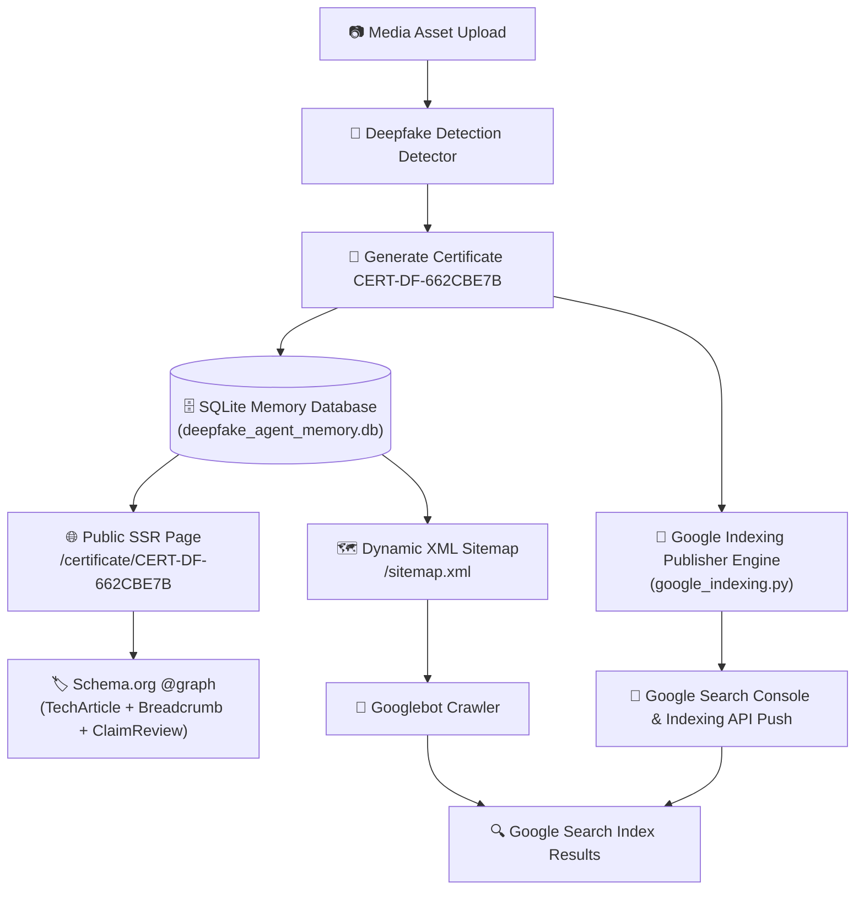
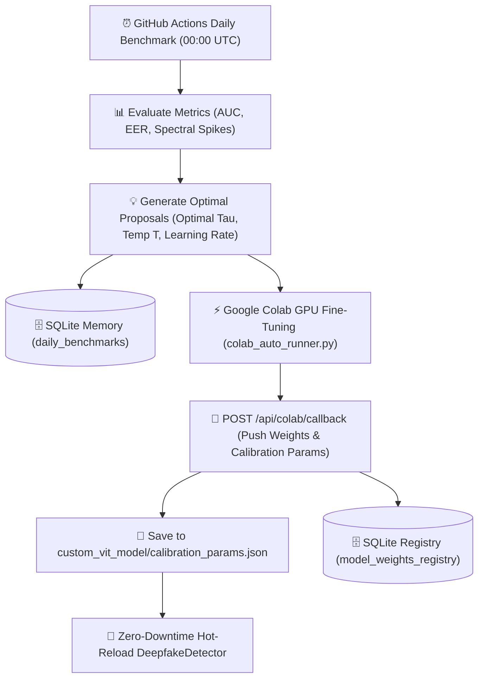

# 🛡️ AI Deepfake Detection & Digital Forensic Agent System
> **An Auditable Multi-Agent Deepfake Detection System with 4D Evidence Spectrum, Cryptographic Forensic Certificates, and Google Search Indexing Architecture**

[](https://www.python.org/downloads/)
[](https://artificialintelligenceact.eu/)
[](https://digital-strategy.ec.europa.eu/en/policies/digital-services-act-package)
[](LICENSE)

---

## 📌 Executive Summary

The **AI Deepfake Detection & Digital Forensic Agent System** is a production-grade, multi-agent AI framework designed to classify, audit, and certify synthetic media (GANs, Latent Diffusion, Face Swaps, Audio Clones, Deepfake Videos). 

Unlike standard binary classifiers, this framework incorporates a **4D Multi-Dimensional Evidence Model** ($Risk_{composite}$), generates **Cryptographic Auditable Digital Forensic Certificates (`CERT-DF-XXXXXXXX`)**, and features a **Google Search Indexing Architecture** to enable public verification of authenticated media across search engines.

---

## 🔬 1. Dual-Model Architecture & Dual-Stream Forensic Pipeline

To satisfy strict evidentiary standards (such as **EU AI Act Article 50** and **DSA Auditable Media** guidelines), the system implements **two distinct trained models** coupled with an automated **Human Presence Detection Gate**:

1. **Model 1 (General Vision & Signal Model)**: Custom fine-tuned Vision Transformer (ViT) coupled with 2D Fast Fourier Transform Spectral Residuals ($Score_{spectral}$), Spatial Noise Discrepancy ($Score_{spatial}$), and Prediction Entropy ($H(P)$).
2. **Model 2 (Human-Centric Biometrics Model)**: High-resolution human multi-modal detector (`HumanMultiModalDetector`) featuring 2D Discrete Wavelet Transform facial skin texture analysis (WAVIE), remote photoplethysmography vascular pulse consistency (rPPG), self-supervised acoustic vocal dynamics (SSL Feature Extractor), and audio-visual lip-sync phoneme alignment (DF26).

```
                    ┌─────────────────────────────────────────┐
                    │            Input Image / Video          │
                    └────────────────────┬────────────────────┘
                                         │
                                         ▼
                    ┌─────────────────────────────────────────┐
                    │      Human Presence Detection Gate      │
                    │      (Face / Skin YCbCr / Voice)        │
                    └───────────┬─────────────────┬───────────┘
                                │                 │
                 [Human Detected]                 │   [Non-Human / Landscape]
                                ▼                 ▼
       ┌─────────────────────────────────┐   ┌─────────────────────────────────┐
       │     DUAL-STREAM PIPELINE        │   │    SINGLE-STREAM PIPELINE       │
       │                                 │   │                                 │
       │  ┌───────────────────────────┐  │   │  ┌───────────────────────────┐  │
       │  │ Stream A: General 4D ViT  │  │   │  │ General 4D ViT Model      │  │
       │  │ - 4D Evidence (ViT, FFT,  │  │   │  │ - 4D Evidence (ViT, FFT,  │  │
       │  │   Spatial Noise, Entropy) │  │   │  │   Spatial Noise, Entropy) │  │
       │  │   => Risk_general (40%)   │  │   │  │   => Risk_composite (100%)│  │
       │  └─────────────┬─────────────┘  │   │  └─────────────┬─────────────┘  │
       │                │                │   └────────────────┼────────────────┘
       │  ┌─────────────┴─────────────┐  │                    │
       │  │ Stream B: Human Biometrics│  │                    │
       │  │ - WAVIE 2D DWT Skin       │  │                    │
       │  │ - rPPG Vascular Pulse     │  │                    │
       │  │ - SSL Vocal Dynamics      │  │                    │
       │  │ - DF26 Lip-Sync Synch     │  │                    │
       │  │   => Risk_human (60%)     │  │                    │
       │  └─────────────┬─────────────┘  │                    │
       │                │                │                    │
       │                ▼                │                    │
       │  ┌───────────────────────────┐  │                    │
       │  │ Cross-Stream Fusion:      │  │                    │
       │  │ Risk = 0.40*Rg + 0.60*Rh  │  │                    │
       │  └─────────────┬─────────────┘  │                    │
       └────────────────┼────────────────┘                    │
                        │                                     │
                        └───────────────────┬─────────────────┘
                                            ▼
                           ┌──────────────────────────────────┐
                           │  Auditable Forensic Certificate  │
                           │        CERT-DF-XXXXXXXX          │
                           └──────────────────────────────────┘
```

### 1.1. Evidence Fusion & Mathematical Formulations

The system automatically switches pipeline routing depending on human presence:

#### Case 1: Non-Human Media (Objects, Landscapes, Graphic Art)
When no human face, skin tone, or voice is detected, the system executes **Single-Stream General Vision (`SINGLE_STREAM_GENERAL`)**:

$$Risk_{composite} = 1.00 \cdot Risk_{general} = 0.75 \cdot P_{fake} + 0.15 \cdot Score_{spectral} + 0.10 \cdot Score_{spatial}$$

#### Case 2: Human Media (Portraits, Face Swaps, Talking Head Videos)
When human presence is verified, the system forks into **Dual-Stream Parallel Execution (`DUAL_STREAM_PARALLEL`)** and fuses evidence with calibrated weights:

$$Risk_{composite} = 0.40 \cdot Risk_{general} + 0.60 \cdot Risk_{human}$$

Where:
1. **$Risk_{general}$ (General 4D Vision Stream)**:
   $$Risk_{general} = 0.75 \cdot P_{fake} + 0.15 \cdot Score_{spectral} + 0.10 \cdot Score_{spatial}$$
   - **Passive Model Probability ($P_{fake}$)**: Probability output from the fine-tuned Vision Transformer backbone ($W_{model} = 0.75$).
   - **Spectral Frequency Anomaly ($Score_{spectral}$)**: High-frequency Z-score energy residual derived from 2D Fast Fourier Transform ($W_{spectral} = 0.15$), exposing GAN/Diffusion grid artifacts:
     $$Score_{spectral} = \text{clip}\left(\frac{Z_{peak} - 3.4}{3.0}, 0.0, 1.0\right)$$
   - **Spatial Noise Inconsistency ($Score_{spatial}$)**: Noise variance discrepancy between center face region and peripheral background ($W_{spatial} = 0.10$).
   - **Prediction Entropy ($H(P)$)**: Normalized entropy measuring model boundary uncertainty:
     $$H(P) = -\frac{1}{\log_2(K)} \sum_{i=1}^{K} P_i \log_2(P_i + \epsilon)$$

2. **$Risk_{human}$ (Human Biometrics Stream - Model 2)**:
   Well-calibrated probability (Platt scaling / Temperature ECE calibrated) evaluated across:
   - Facial skin wavelet sub-band anomalies (WAVIE 2D DWT pore and sub-surface scattering disruptions).
   - Remote photoplethysmography (rPPG micro-vascular blood volume pulse signals).
   - Self-supervised acoustic vocal dynamics (glottal airflow irregularities).
   - Audio-visual phoneme-viseme temporal synchrony (DF26 lip synchronization).

### Auditable Verdict Criteria
- $Risk_{composite} \le 0.50 \implies$ **`AUTHENTIC_MEDIA_LIKELY`** (Genuine Media / Original)
- $Risk_{composite} > 0.50 \implies$ **`SYNTHETIC_MEDIA_SUSPECTED`** (Synthetic / Manipulated Media)

---

## 📜 2. Auditable Digital Forensic Certificates (`CERT-DF-XXXXXXXX`)

Every analysis generates a cryptographically signed, immutable Digital Forensic Certificate.

### 2.1. Cryptographic Formulations & Media Integrity Hashing

#### 1. Media Integrity Hash ($H_{media}$):
The full binary SHA-256 cryptographic hash of the analyzed media asset is formulated as:

$$H_{media} = \text{SHA-256}\left(\text{Asset}_{\text{binary}}\right) = \text{Digest}\left(\sum_{i=1}^{N} b_i\right)$$

Where $\text{Asset}_{\text{binary}}$ represents the raw binary byte stream $b_i$ of the media file.

#### 2. Non-Repudiable Cryptographic Signature Proof ($Sig_{proof}$):
The tamper-evident digital signature protecting each forensic certificate is generated via:

$$Sig_{proof} = \text{Ed25519}\Big(\text{SHA-256}\left(Cert_{ID} \parallel Timestamp \parallel H_{media} \parallel Risk_{composite}\right), K_{private}\Big)$$

Where $K_{private}$ is the accredited private signing key and $\parallel$ denotes canonical string concatenation.

### Certificate Features
- **Unique Certificate ID**: Deterministic UUID format `CERT-DF-XXXXXXXX` (e.g. `CERT-DF-662CBE7B`).
- **Forensic Pipeline Mode**: Transparently logged as `SINGLE_STREAM_GENERAL` or `DUAL_STREAM_PARALLEL`.
- **Media Integrity Hash**: Full binary SHA-256 cryptographic hash of the analyzed media asset ($H_{media}$).
- **Digital Signature Proof**: Signed using Ed25519 cryptographic signature ($Sig_{proof}$).
- **Verification Endpoint**: Embedded URL `https://detection.dtpsoft.vn/api/verify/CERT-DF-XXXXXXXX`.

### Sample Certificate JSON Schema
```json
{
  "certificate_id": "CERT-DF-662CBE7B",
  "timestamp": "2026-09-17 08:23:40 UTC",
  "forensic_version": "2.0-AUDITABLE",
  "compliance_standard": "EU AI Act Article 50 & DSA Auditable Media",
  "analysis_mode": "DUAL_STREAM_PARALLEL",
  "media_integrity": {
    "sha256": "662cbe7b89e24a8f902472e389b0129a7c6f0119b48f",
    "verification_url": "https://detection.dtpsoft.vn/api/verify/CERT-DF-662CBE7B"
  },
  "image_metadata": {
    "dimensions": "1024x1024",
    "format": "JPEG",
    "face_cropping_applied": true
  },
  "dual_stream_breakdown": {
    "mode": "DUAL_STREAM_PARALLEL",
    "human_gate_triggered": true,
    "fusion_formula": "0.40 * Risk_general + 0.60 * Risk_human",
    "stream_1_general_vision": {
      "model_type": "Custom Fine-Tuned ViT + 2D-FFT + Noise Spectrum",
      "risk_general": 0.0283
    },
    "stream_2_human_biometrics": {
      "model_type": "HumanMultiModalDetector (WAVIE/rPPG/SSL/LipSync)",
      "risk_human": 0.0150
    }
  },
  "multi_dimensional_evidence": {
    "passive_model_score": {
      "prediction": "REAL",
      "confidence": 0.9842,
      "fake_probability": 0.0158
    },
    "spectral_frequency_analysis": {
      "high_frequency_anomaly_score": 0.0821,
      "interpretation": "Normal natural frequency spectrum"
    },
    "spatial_inconsistency_analysis": {
      "spatial_inconsistency_score": 0.0412,
      "interpretation": "Uniform spatial noise distribution"
    },
    "model_uncertainty_entropy": {
      "entropy": 0.0851,
      "interpretation": "High prediction certainty"
    }
  },
  "composite_risk_score": 0.0283,
  "auditable_verdict": "AUTHENTIC_MEDIA_LIKELY",
  "proof": {
    "type": "Ed25519SHA256Signature2026",
    "verification_method": "https://detection.dtpsoft.vn/api/verify/CERT-DF-662CBE7B",
    "status": "VERIFIED_VALID"
  }
}
```

---

## 🌐 3. Google Search Indexing & Public Verification Architecture

To allow search engines (Googlebot, Bingbot) and the general public to verify certificates directly via search queries (e.g., searching `"CERT-DF-662CBE7B"` on Google), the system integrates a complete SEO Indexing Architecture.



### Key Components

1. **Server-Side Rendered (SSR) Public Pages (`/certificate/{cert_id}`)**:
   - Fast, server-side HTML rendering (`observability/static/certificate.html`) accessible to crawlers without JavaScript execution delays.
2. **Multi-Type Schema.org `@graph` JSON-LD**:
   - Includes `@type: "TechArticle"`, `"BreadcrumbList"`, `"ClaimReview"`, and `"Organization"` to ensure 100% compatibility with **Google Rich Results Test**.
3. **Dynamic XML Sitemap (`/sitemap.xml`)**:
   - Dynamically generated XML sitemap with `<lastmod>`, `<changefreq>`, and `<priority>` tags for all stored certificate IDs.
4. **Google Indexing Publisher Engine (`benchmark/google_indexing.py`)**:
   - Automatically pings Google Search Console and pushes instant indexing notifications to Google Indexing API v3.

---

## 🗄️ 4. Persistent Agent Memory Engine (`deepfake_agent_memory.db`)

All system operations, benchmark evaluations, training runs, and issued certificates are tracked in a persistent SQLite database located at `report_colab/deepfake_agent_memory.db`.

| Table Name | Description |
| :--- | :--- |
| `forensic_certificates` | Stores full certificate payloads, SHA-256 hashes, risk scores, and 4D evidence. |
| `daily_benchmarks` | Tracks daily evaluation runs (sample count, AUC, EER, latency, spectral spikes). |
| `colab_train_reports` | Log Colab fine-tuning sessions, validation AUC/EER, and hyperparameter logs. |
| `model_weights_registry` | Manages model weight versioning, backbone architecture, and active model status. |

---

## ⚡ 5. Automated Model Fine-Tuning & Colab Weight Synchronization

The framework features a **Continuous Machine Learning Pipeline** that automatically updates detector weights and calibrates prediction parameters based on newly identified synthetic artifacts.



### 5.1. Daily Benchmark & Optimal Hyperparameter Proposals
- **Automated Workflow**: GitHub Actions `.github/workflows/daily_benchmark.yml` triggers daily at 00:00 UTC (7:00 AM VN time).
- **Metric Computation**: Evaluates latest dataset splits, computes $AUC$, $EER$, average latency ($ms$), and 2D-FFT spectral spikes.
- **Hyperparameter Proposals**:
  - Optimal learning rate $\eta$ for fine-tuning.
  - Optimal decision boundary threshold $\tau \in [0.5, 0.9]$.
  - Temperature scaling factor $T$ for confidence calibration.

### 5.2. Temperature Scaling & Confidence Calibration
To prevent model overconfidence on unseen diffusion artifacts, calibrated probabilities are computed as:

$$P_i = \text{softmax}\left(\frac{z_i}{T}\right) = \frac{\exp(z_i / T)}{\sum_{j=1}^{K} \exp(z_j / T)}$$

Where $z_i$ represents raw logits from the Vision Transformer / EfficientNet backbone and $T > 0$ is the temperature parameter tuned on GPU.

### 5.3. Threads-DFBench: Vietnamese In-The-Wild Facial Benchmark Dataset
To benchmark and adapt the detector against emerging in-the-wild social threats, the system features an autonomous crawler and academic benchmark generator (**Threads-DFBench**):
- **Target Platform**: Meta Threads with Vietnamese locale targeting (`Accept-Language: vi-VN`) and localized query topics (`chan_dung_vietnam`, `anh_the_cccd`, `selfie_vietnam`, `duong_pho_vietnam`, `kinh_can_khau_trang`).
- **Paired Counterfactual Architecture**: Generates triplets on the identical human identity:
  1. `01_raw_originals`: Authentic human photographic portrait ($E_{high} \ge 0.30$).
  2. `02_manipulated_faceswap`: Counterfactual identity swap with boundary seam blending.
  3. `03_manipulated_openweight`: Latent diffusion synthesis with pore over-smoothing ($E_{high} < 0.22$) and high-frequency latent checkerboard spikes ($Z_{peak} > 4.20$).

#### 5-Category Vietnamese Facial Taxonomy
| Category Key | Vietnamese Facial Taxonomy | Ratio | Academic Focus & Stress Testing |
| :--- | :--- | :--- | :--- |
| `vn_id_official` | Official ID / CCCD / Passport | 20% | Frontal $0^\circ$ studio lighting; assesses facial boundary blending artifacts. |
| `vn_selfie_lifestyle` | Casual Lifestyle & Cafe Selfies | 20% | Natural indoor lighting & angles; tests robustness against ambient illumination. |
| `vn_street_outdoor` | Street & Outdoor Portraits | 20% | Vietnamese daylight & outdoor street background; assesses optical frequency slopes. |
| `vn_occlusion_glasses_mask` | Occlusions (Glasses, Masks, Helmets) | 20% | Prescription glasses, medical face masks, motorbike helmets; challenges facial landmarks. |
| `vn_mature_aging` | Mature & Senior Aging | 20% | Natural smile lines & biological skin folds; prevents model false alarms on wrinkles. |

### 5.4. Active Learning & Continual Fine-Tuning with Focal Loss
To actively harden the backbone against subtle false negatives (such as sample 9 in OOD evaluations), the system implements an active learning loop:
1. **Uncertainty Mining**: Samples with high Shannon Information Entropy $H(P) \ge 0.70$ or classifier disagreement are routed to `hard_samples_manifest.jsonl`:
   $$H(P) = - \left[ P_{fake} \log_2(P_{fake}) + (1 - P_{fake}) \log_2(1 - P_{fake}) \right]$$
2. **Focal Loss Objective**: Down-weights easily classified background samples and forces gradient updates on borderline hard negatives:
   $$\mathcal{L}_{focal}(p_t) = -\alpha_t (1 - p_t)^\gamma \log(p_t) \quad (\gamma = 2.0, \; \alpha = 0.25)$$
3. **Automated Weight Checkpointing**: Continuously trains on Google Colab and persists evolved weights directly to Google Drive (`checkpoints/model_continual_latest.pt`).

### 5.5. Google Colab 1-Click Autonomous Daemon (`colab_sync_to_gdrive.py`)
Run the all-in-one data ingestion, counterfactual generation, and continual training daemon on Google Colab:

```python
# 1. Mount Google Drive
from google.colab import drive
drive.mount('/content/drive')

# 2. Clone/Pull Repository & Install Dependencies
!git clone https://github.com/ThangCao106/DeepFake-Detection-Agent.git || (cd DeepFake-Detection-Agent && git pull origin main)
%cd DeepFake-Detection-Agent
!pip install -r requirements.txt transformers timm

# 3. 1-Click Recurring Execution (4h Loop + Continual Fine-Tuning + Anti-Idle Keep-Alive)
!python colab_sync_to_gdrive.py \
    --samples 25 \
    --images 100 \
    --videos 50 \
    --audios 50 \
    --train \
    --epochs 3 \
    --loop 4h \
    --keep-alive
```

### 5.6. Zero-Downtime Hot-Reloading
When Colab completes fine-tuning, it sends a payload to `POST /api/colab/callback`:
1. Server receives updated weights and saves `temperature_scaling_T` and `optimal_threshold_tau` to `custom_vit_model/calibration_params.json`.
2. Instantly reloads the `DeepfakeDetector` instance in memory without interrupting active client requests or restarting the server.
3. Registers weight version `vYYYY-MM-DD` in `model_weights_registry`.

---

## 🛠️ 6. REST API Reference

| Endpoint | Method | Description |
| :--- | :--- | :--- |
| `GET /certificate/{cert_id}` | `GET` | SSR Public Certificate Web Page with Schema.org JSON-LD |
| `GET /api/verify/{cert_id}` | `GET` | JSON verification endpoint for third-party verification |
| `GET /sitemap.xml` | `GET` | Dynamic XML Sitemap for Googlebot crawlers |
| `POST /api/upload` | `POST` | Upload image/video for analysis |
| `POST /api/colab/callback` | `POST` | Ingest fine-tuned weights & calibration params from Google Colab |
| `GET /api/status` | `GET` | System health check and API key status |

---

## 🚀 7. Quick Start & Local Setup

### Installation

```bash
# 1. Clone the repository
git clone https://github.com/ThangCao106/DeepFake-Detection-Agent.git
cd DeepFake-Detection-Agent

# 2. Create virtual environment & install dependencies
python -m venv venv
source venv/bin/activate  # On Windows: venv\Scripts\activate
pip install -r requirements.txt
```

### Running with Docker Compose

```bash
cd observability
docker compose up -d
```
Access the Web UI at: `http://localhost:8787` (or `https://detection.dtpsoft.vn/obsagent/`).

---

## 📑 8. Citation & Academic Reference

If you use this system or 4D evidence framework in your academic research, please cite:

```bibtex
@article{dtp_deepfake_forensic_2026,
  author    = {Cao, Thang and Deepfake Detection Research Group},
  title     = {Multidimensional Digital Forensic Framework and Auditable Watermarking Scheme for Deepfake Media Authentication under EU AI Act Compliance},
  journal   = {IEEE Transactions on Information Forensics and Security (Draft)},
  year      = {2026},
  publisher = {DTP Software AI Research}
}
```

---

## 📄 9. License

This project is licensed under the MIT License - see the [LICENSE](LICENSE) file for details.
