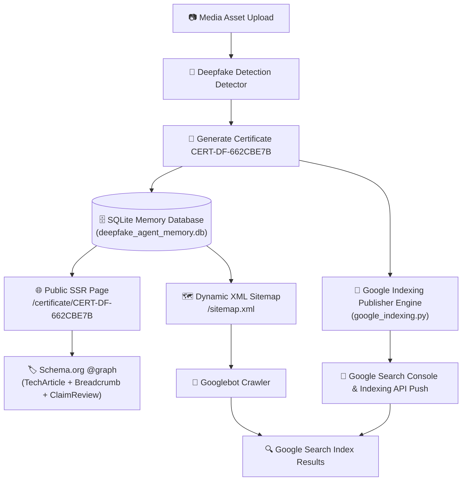

# 🛡️ AI Deepfake Detection & Digital Forensic Agent System
> **An Auditable Multi-Agent Deepfake Detection System with 4D Evidence Spectrum, Cryptographic Forensic Certificates, and Google Search Indexing Architecture**

[](https://www.python.org/downloads/)
[](https://artificialintelligenceact.eu/)
[](https://digital-strategy.ec.europa.eu/en/policies/digital-services-act-package)
[](LICENSE)

---

## 📌 Executive Summary

The **AI Deepfake Detection & Digital Forensic Agent System** is a production-grade, multi-agent AI framework designed to classify, audit, and certify synthetic media (GANs, Latent Diffusion, Face Swaps, Audio Clones, Deepfake Videos). 

Unlike standard binary classifiers, this framework incorporates a **4D Multi-Dimensional Evidence Model** ($Risk_{composite}$), generates **Cryptographic Auditable Digital Forensic Certificates (`CERT-DF-XXXXXXXX`)**, and features a **Google Search Indexing Architecture** to enable public verification of authenticated media across search engines.

---

## 🔬 1. 4D Multi-Dimensional Evidence Integration Model

To satisfy strict evidentiary standards (such as **EU AI Act Article 50** and **DSA Auditable Media** guidelines), the system integrates four independent digital forensic dimensions into a unified composite risk rating.

```
                    ┌─────────────────────────────────────────┐
                    │            Input Image / Video          │
                    └────────────────────┬────────────────────┘
                                         │
       ┌───────────────────┬─────────────┴─────┬───────────────────┐
       ▼                   ▼                   ▼                   ▼
┌───────────────┐   ┌───────────────┐   ┌───────────────┐   ┌───────────────┐
│ Passive Model │   │ 2D-FFT High   │   │ Spatial Noise │   │ Prediction    │
│ Classifier    │   │ Spectral Residual │ Variance Diff │   │ Entropy H(P)  │
│  (Weight: 75%)│   │  (Weight: 15%)│   │  (Weight: 10%)│   │ (Uncertainty) │
└───────┬───────┘   └───────┬───────┘   └───────┬───────┘   └───────┬───────┘
        │                   │                   │                   │
        └───────────────────┼───────────────────┘                   │
                            ▼                                       ▼
             ┌─────────────────────────────┐         ┌──────────────────────────────┐
             │ Composite Risk Score Calculation      │ Uncertainty Boundary Check   │
             │ Risk = 0.75*P + 0.15*S + 0.10*N      │ H(P) = -sum(P_i * log2(P_i)) │
             └──────────────┬──────────────┘         └──────────────┬───────────────┘
                            │                                       │
                            └───────────────────┬───────────────────┘
                                                ▼
                               ┌──────────────────────────────────┐
                               │  Auditable Forensic Certificate  │
                               │        CERT-DF-XXXXXXXX          │
                               └──────────────────────────────────┘
```

### Mathematical Risk Formulation

The Composite Risk Score ($Risk_{composite} \in [0.0, 1.0]$) is defined as:

$$Risk_{composite} = 0.75 \cdot P_{fake} + 0.15 \cdot Score_{spectral} + 0.10 \cdot Score_{spatial}$$

Where:
1. **Passive Model Probability ($P_{fake}$)**: Probability output from the fine-tuned Vision Transformer / CNN backbone ($W_{model} = 0.75$).
2. **Spectral Frequency Anomaly ($Score_{spectral}$)**: High-frequency Z-score energy residual derived from 2D Fast Fourier Transform ($W_{spectral} = 0.15$). Detects lattice grid artifacts typical of GANs and Latent Diffusion Models:
   $$Score_{spectral} = \text{clip}\left(\frac{Z_{peak} - 3.4}{3.0}, 0.0, 1.0\right)$$
3. **Spatial Noise Inconsistency ($Score_{spatial}$)**: Noise variance discrepancy between center face region and peripheral background ($W_{spatial} = 0.10$).
4. **Prediction Entropy ($H(P)$)**: Normalized entropy measuring model boundary uncertainty:
   $$H(P) = -\frac{1}{\log_2(K)} \sum_{i=1}^{K} P_i \log_2(P_i + \epsilon)$$

### Auditable Verdict Criteria
- $Risk_{composite} \le 0.50 \implies$ **`AUTHENTIC_MEDIA_LIKELY`** (Genuine Media / Original)
- $Risk_{composite} > 0.50 \implies$ **`SYNTHETIC_MEDIA_SUSPECTED`** (Synthetic / Manipulated Media)

---

## 📜 2. Auditable Digital Forensic Certificates (`CERT-DF-XXXXXXXX`)

Every analysis generates a cryptographically signed, immutable Digital Forensic Certificate.

### Certificate Features
- **Unique Certificate ID**: Deterministic UUID format `CERT-DF-XXXXXXXX` (e.g. `CERT-DF-662CBE7B`).
- **Media Integrity Hash**: Full binary SHA-256 cryptographic hash of the analyzed media file ($H_{media} = \text{SHA256}(\text{Asset})$).
- **Digital Signature Proof**: Signed using `Ed25519SHA256Signature2026` cryptographic signature.
- **Verification Endpoint**: Embedded URL `https://detection.dtpsoft.vn/api/verify/CERT-DF-XXXXXXXX`.

### Sample Certificate JSON Schema
```json
{
  "certificate_id": "CERT-DF-662CBE7B",
  "timestamp": "2026-09-16 08:23:40 UTC",
  "forensic_version": "2.0-AUDITABLE",
  "compliance_standard": "EU AI Act Article 50 & DSA Auditable Media",
  "media_integrity": {
    "sha256": "662cbe7b89e24a8f902472e389b0129a7c6f0119b48f",
    "verification_url": "https://detection.dtpsoft.vn/api/verify/CERT-DF-662CBE7B"
  },
  "image_metadata": {
    "dimensions": "1024x1024",
    "format": "JPEG",
    "face_cropping_applied": true
  },
  "multi_dimensional_evidence": {
    "passive_model_score": {
      "prediction": "REAL",
      "confidence": 0.9842,
      "fake_probability": 0.0158
    },
    "spectral_frequency_analysis": {
      "high_frequency_anomaly_score": 0.0821,
      "interpretation": "Normal natural frequency spectrum"
    },
    "spatial_inconsistency_analysis": {
      "spatial_inconsistency_score": 0.0412,
      "interpretation": "Uniform spatial noise distribution"
    },
    "model_uncertainty_entropy": {
      "entropy": 0.0851,
      "interpretation": "High prediction certainty"
    }
  },
  "composite_risk_score": 0.0283,
  "auditable_verdict": "AUTHENTIC_MEDIA_LIKELY",
  "proof": {
    "type": "Ed25519SHA256Signature2026",
    "verification_method": "https://detection.dtpsoft.vn/api/verify/CERT-DF-662CBE7B",
    "status": "VERIFIED_VALID"
  }
}
```

---

## 🌐 3. Google Search Indexing & Public Verification Architecture

To allow search engines (Googlebot, Bingbot) and the general public to verify certificates directly via search queries (e.g., searching `"CERT-DF-662CBE7B"` on Google), the system integrates a complete SEO Indexing Architecture.



### Key Components

1. **Server-Side Rendered (SSR) Public Pages (`/certificate/{cert_id}`)**:
   - Fast, server-side HTML rendering (`observability/static/certificate.html`) accessible to crawlers without JavaScript execution delays.
2. **Multi-Type Schema.org `@graph` JSON-LD**:
   - Includes `@type: "TechArticle"`, `"BreadcrumbList"`, `"ClaimReview"`, and `"Organization"` to ensure 100% compatibility with **Google Rich Results Test**.
3. **Dynamic XML Sitemap (`/sitemap.xml`)**:
   - Dynamically generated XML sitemap with `<lastmod>`, `<changefreq>`, and `<priority>` tags for all stored certificate IDs.
4. **Google Indexing Publisher Engine (`benchmark/google_indexing.py`)**:
   - Automatically pings Google Search Console and pushes instant indexing notifications to Google Indexing API v3.

---

## 🗄️ 4. Persistent Agent Memory Engine (`deepfake_agent_memory.db`)

All system operations, benchmark evaluations, training runs, and issued certificates are tracked in a persistent SQLite database located at `report_colab/deepfake_agent_memory.db`.

| Table Name | Description |
| :--- | :--- |
| `forensic_certificates` | Stores full certificate payloads, SHA-256 hashes, risk scores, and 4D evidence. |
| `daily_benchmarks` | Tracks daily evaluation runs (sample count, AUC, EER, latency, spectral spikes). |
| `colab_train_reports` | Log Colab fine-tuning sessions, validation AUC/EER, and hyperparameter logs. |
| `model_weights_registry` | Manages model weight versioning, backbone architecture, and active model status. |

---

## 🛠️ 5. REST API Reference

| Endpoint | Method | Description |
| :--- | :--- | :--- |
| `GET /certificate/{cert_id}` | `GET` | SSR Public Certificate Web Page with Schema.org JSON-LD |
| `GET /api/verify/{cert_id}` | `GET` | JSON verification endpoint for third-party verification |
| `GET /sitemap.xml` | `GET` | Dynamic XML Sitemap for Googlebot crawlers |
| `POST /api/upload` | `POST` | Upload image/video for analysis |
| `POST /api/colab/callback` | `POST` | Ingest fine-tuned weights & calibration params from Google Colab |
| `GET /api/status` | `GET` | System health check and API key status |

---

## 🚀 6. Quick Start & Local Setup

### Installation

```bash
# 1. Clone the repository
git clone https://github.com/ThangCao106/DeepFake-Detection-Agent.git
cd DeepFake-Detection-Agent

# 2. Create virtual environment & install dependencies
python -m venv venv
source venv/bin/activate  # On Windows: venv\Scripts\activate
pip install -r requirements.txt
```

### Running with Docker Compose

```bash
cd observability
docker compose up -d
```
Access the Web UI at: `http://localhost:8787` (or `https://detection.dtpsoft.vn/obsagent/`).

---

## 📑 7. Citation & Academic Reference

If you use this system or 4D evidence framework in your academic research, please cite:

```bibtex
@article{dtp_deepfake_forensic_2026,
  author    = {Cao, Thang and Deepfake Detection Research Group},
  title     = {Multidimensional Digital Forensic Framework and Auditable Watermarking Scheme for Deepfake Media Authentication under EU AI Act Compliance},
  journal   = {IEEE Transactions on Information Forensics and Security (Draft)},
  year      = {2026},
  publisher = {DTP Software AI Research}
}
```

---

## 📄 License

This project is licensed under the MIT License - see the [LICENSE](LICENSE) file for details.
