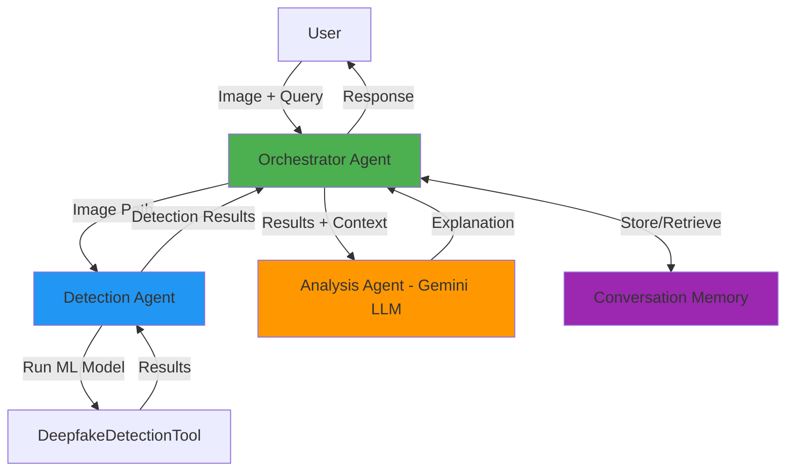

# 🤖 Deepfake Detection Agent System

An intelligent multi-agent system for detecting AI-generated deepfake images, powered by Google Gemini and built for the **Kaggle Agents Intensive Capstone Project**.


## 🎯 Problem Statement

**The Challenge**: The proliferation of AI-generated deepfake images poses serious threats to information integrity, personal privacy, and public trust. Manual detection is time-consuming and requires expertise.

**The Solution**: An AI agent system that not only detects deepfakes but also explains the results in natural language, answers follow-up questions, and maintains conversation context for iterative analysis.

## 🌟 Why Agents?

Traditional deepfake detection tools provide binary outputs without explanation. This **multi-agent system** offers:

1. **🤖 Automated Detection** - ML model analyzes images automatically
2. **💬 Intelligent Explanation** - LLM-powered agent explains results in plain language
3. **❓ Interactive Q&A** - Users can ask follow-up questions about detections
4. **🧠 Context Awareness** - Conversation memory enables multi-turn interactions
5. **📊 Observability** - Full logging and tracing for transparency

## 🏗️ Architecture

### Multi-Agent System Design


## 📷 Project Demo


## 📁 Modular System Architecture

```text
DeepFake-Detection-Agent/
├── 🌐 web_ui/                            (Phần Ứng dụng & Giao diện Suy luận)
│   ├── app.py                            - Flask Web Server & SocketIO (Port 5000)
│   ├── templates/ & static/              - Giao diện Light Lavender UI & Multi-Modality Viewer
│   ├── deepfake_detector.py              - Engine suy luận Image, Video, Audio & Certificate ID
│   ├── agent_system.py                   - Multi-Agent Orchestrator & Claude/Gemini Fallback
│   └── config.py                         - App Configuration Manager
│
├── 🧠 colab_training/                    (Phần Huấn luyện & Tự động hóa Colab GPU)
│   ├── colab_auto_runner.py              - Smart Hybrid Continuous Auto-Runner Engine
│   ├── colab_dataset_pipeline.py         - Manager dữ liệu Multi-Modality & Auto-Sync GitHub
│   ├── train_pipeline.py                 - Two-Stage ViT Fine-Tuning Pipeline (Image/Video/Audio)
│   ├── data_pipeline.py                  - Registry Awesome-Deepfakes Datasets
│   ├── upload_model_cloud.py             - Auto Upload Trọng số lên Hugging Face Hub
│   └── Colab_MultiModality_AutoTrainer.ipynb - Notebook Form UI trên Google Colab GPU
│
├── 🔍 observability/                     (Phần Agent Quan sát & Persistent Memory)
│   ├── Dockerfile & docker-compose.yml   - Subsystem SRE Claude Agent Service (Port 8787)
│   ├── app/ & static/                    - Core Agent Implementation
│   └── MEMORY_SETUP.md                   - Audit Memory & Knowledge Base
│
└── 📊 benchmark/                         (Phần Đánh giá Benchmark & Hiệu chỉnh Mô hình)
    ├── eval_benchmark.py                 - Evaluator đo AUC, EER, LogLoss, Accuracy
    ├── calibrate.py                      - Temperature Scaling & Optimal Threshold Finder
    ├── hf_dataset_scout.py               - Scout & Audit Hugging Face Candidate Datasets
    ├── export_onnx.py                    - ONNX Exporter & Quantization Engine
    └── benchmark_results.json            - Kết quả Benchmark & Metrics Baseline
```

## 🚀 8-Stage ViT Fine-Tuning & Hugging Face Dataset Scout Pipeline

### 🔍 Automated Hugging Face Dataset Scout (`hf_dataset_scout.py`)

Scans Hugging Face Datasets (`https://huggingface.co/datasets?sort=trending&search=deepfake`) using a **6-Stage Automated Audit Workflow**:

1. **HF Search**: Query candidate datasets matching `deepfake` / `synthetic-image`.
2. **Image + Deepfake Filter**: Verify `image` modality & real/fake binary targets.
3. **Metadata Inspection**: Parse features schema, tags, and split row counts.
4. **Label Check**: Confirm ground-truth label presence (`real`/`fake`, `0`/`1`).
5. **License Audit**: Classify into `PERMISSIVE` (MIT, Apache-2.0, CC-BY) vs `RESEARCH_ONLY` vs `RESTRICTED`.
6. **Training Queue & Log**: Log full execution history in `dataset_pipeline/history_log.json` with ISO-8601 timestamps and export qualified datasets to `dataset_pipeline/training_queue.json`.

```bash
# Run HF Scout Pipeline
py -3 hf_dataset_scout.py --search deepfake --max-results 25
```

---

### ☁️ Cloud Model Upload (`upload_model_cloud.py`)

Uploads fine-tuned ViT weights, ONNX export, and calibration parameters ($T^* = 1.6178$, $\tau^* = 0.8118$) to Hugging Face Hub:

```bash
$env:HF_TOKEN="your_huggingface_write_token"
py -3 upload_model_cloud.py --repo-id ThangCao106/custom-deepfake-vit
```

---

### ⚡ Google Colab GPU Fine-Tuning (`deepfake_colab_training.ipynb`)

Run large-scale training on Google Colab GPUs (T4/A100) using qualified datasets from `training_queue.json`:

1. Open `deepfake_colab_training.ipynb` in Google Colab.
2. Connect to GPU runtime.
3. Execute cells to pull qualified Hugging Face datasets and train at scale.


