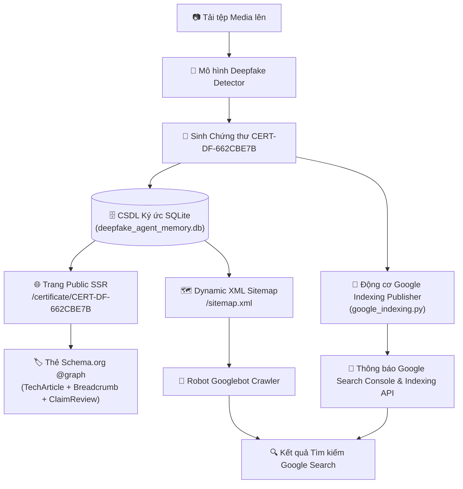

# 🛡️ AI Deepfake Detection & Digital Forensic Agent System
> **Hệ thống Multi-Agent Phát hiện Deepfake & Giám định Kỹ thuật số với Mô hình Bằng chứng 4D, Chứng thư Mật mã hóa và Kiến trúc Lập chỉ mục Google Search**

[](https://www.python.org/downloads/)
[](https://artificialintelligenceact.eu/)
[](https://digital-strategy.ec.europa.eu/en/policies/digital-services-act-package)
[](LICENSE)

---

## 📌 Tóm tắt Hệ thống (Executive Summary)

**Hệ thống AI Deepfake Detection & Digital Forensic Agent** là một nền tảng Multi-Agent cấp công nghiệp được thiết kế để phân loại, kiểm toán và cấp chứng thư pháp y kỹ thuật số cho các phương tiện truyền thông tổng hợp (GANs, Latent Diffusion, Face Swaps, Audio Clones, Deepfake Videos).

Khác với các mô hình phân loại nhị phân thông thường, hệ thống tích hợp **Mô hình Bằng chứng Giám định Đa chiều 4D** ($Risk_{composite}$), tự động phát hành **Chứng thư Kỹ thuật số (`CERT-DF-XXXXXXXX`)** có chữ ký mật mã hóa, và sở hữu **Kiến trúc Lập chỉ mục Google Search (SEO Indexing Architecture)** cho phép xác thực công khai chứng thư trên Google và các công cụ tìm kiếm.

---

## 🔬 1. Mô hình Tích hợp Bằng chứng Pháp y Đa chiều 4D (4D Evidence Integration)

Để đáp ứng các tiêu chuẩn pháp lý nghiêm ngặt (như quy định **EU AI Act Article 50** và **DSA Auditable Media**), hệ thống tích hợp 4 chỉ số pháp y kỹ thuật số độc lập thành một điểm rủi ro tổng hợp thống nhất.

```
                    ┌─────────────────────────────────────────┐
                    │            Tệp Ảnh / Video Đầu vào      │
                    └────────────────────┬────────────────────┘
                                         │
       ┌───────────────────┬─────────────┴─────┬───────────────────┐
       ▼                   ▼                   ▼                   ▼
┌───────────────┐   ┌───────────────┐   ┌───────────────┐   ┌───────────────┐
│ Mô hình Thụ   │   │ Dị thường Tần │   │ Biến thiên    │   │ Độ bất định   │
│ động ViT/CNN  │   │ số 2D-FFT     │   │ Nhiễu Không   │   │ Entropy H(P)  │
│  (Trọng số 75%)│  │ (Trọng số 15%)│   │ gian (T.số 10%)│  │ (Uncertainty) │
└───────┬───────┘   └───────┬───────┘   └───────┬───────┘   └───────┬───────┘
        │                   │                   │                   │
        └───────────────────┼───────────────────┘                   │
                            ▼                                       ▼
             ┌─────────────────────────────┐         ┌──────────────────────────────┐
             │ Tính Điểm Rủi ro Tổng hợp   │         │ Kiểm tra Ranh giới Entropy   │
             │ Risk = 0.75*P + 0.15*S + 0.10*N      │ H(P) = -sum(P_i * log2(P_i)) │
             └──────────────┬──────────────┘         └──────────────┬───────────────┘
                            │                                       │
                            └───────────────────┬───────────────────┘
                                                ▼
                               ┌──────────────────────────────────┐
                               │  Chứng thư Giám định Kỹ thuật số │
                               │        CERT-DF-XXXXXXXX          │
                               └──────────────────────────────────┘
```

### Công thức Toán học Điểm Rủi ro Tổng hợp (Composite Risk Score)

Điểm rủi ro tổng hợp ($Risk_{composite} \in [0.0, 1.0]$) được tính theo công thức:

$$Risk_{composite} = 0.75 \cdot P_{fake} + 0.15 \cdot Score_{spectral} + 0.10 \cdot Score_{spatial}$$

Trong đó:
1. **Xác suất Mô hình Thụ động ($P_{fake}$)**: Xác suất dự đoán Deepfake từ mạng Vision Transformer / CNN đã được tinh chỉnh ($W_{model} = 0.75$).
2. **Dị thường Tần số 2D-FFT ($Score_{spectral}$)**: Điểm dải tần số cao Z-score tính từ biến đổi Fast Fourier Transform 2D ($W_{spectral} = 0.15$). Nhận diện nhiễu ma trận đặc trưng của mô hình GAN và Diffusion:
   $$Score_{spectral} = \text{clip}\left(\frac{Z_{peak} - 3.4}{3.0}, 0.0, 1.0\right)$$
3. **Độ bất tương đồng Nhiễu Không gian ($Score_{spatial}$)**: Chênh lệch phương sai nhiễu giữa vùng khuôn mặt trung tâm và vùng nền ($W_{spatial} = 0.10$).
4. **Độ bất định Entropy ($H(P)$)**: Chỉ số Entropy chuẩn hóa đo lường độ bất định tại ranh giới dự đoán:
   $$H(P) = -\frac{1}{\log_2(K)} \sum_{i=1}^{K} P_i \log_2(P_i + \epsilon)$$

### Tiêu chuẩn Kết luận Giám định
- $Risk_{composite} \le 0.50 \implies$ **`AUTHENTIC_MEDIA_LIKELY`** (Phương tiện thực / Nguyên bản)
- $Risk_{composite} > 0.50 \implies$ **`SYNTHETIC_MEDIA_SUSPECTED`** (Phương tiện tổng hợp / Deepfake nghi vấn)

---

## 📜 2. Chứng thư Giám định Kỹ thuật số (`CERT-DF-XXXXXXXX`)

Mỗi lượt phân tích tự động tạo ra một Chứng thư Giám định Kỹ thuật số có chữ ký mật mã hóa và lưu trữ bất biến.

### Đặc tính Chứng thư
- **Mã Chứng thư Độc bản**: Định dạng UUID chuẩn `CERT-DF-XXXXXXXX` (ví dụ: `CERT-DF-662CBE7B`).
- **Mã Hash SHA-256 Phương tiện**: Mã hóa SHA-256 toàn vẹn tệp truyền thông ($H_{media} = \text{SHA256}(\text{Asset})$).
- **Chữ ký Mật mã hóa**: Ký số bảo mật Ed25519 (`Ed25519SHA256Signature2026`).
- **Đường dẫn Tra cứu Trực tuyến**: URL nhúng `https://detection.dtpsoft.vn/api/verify/CERT-DF-XXXXXXXX`.

### Mẫu JSON Chứng thư Tiêu chuẩn
```json
{
  "certificate_id": "CERT-DF-662CBE7B",
  "timestamp": "2026-09-16 08:23:40 UTC",
  "forensic_version": "2.0-AUDITABLE",
  "compliance_standard": "EU AI Act Article 50 & DSA Auditable Media",
  "media_integrity": {
    "sha256": "662cbe7b89e24a8f902472e389b0129a7c6f0119b48f",
    "verification_url": "https://detection.dtpsoft.vn/api/verify/CERT-DF-662CBE7B"
  },
  "image_metadata": {
    "dimensions": "1024x1024",
    "format": "JPEG",
    "face_cropping_applied": true
  },
  "multi_dimensional_evidence": {
    "passive_model_score": {
      "prediction": "REAL",
      "confidence": 0.9842,
      "fake_probability": 0.0158
    },
    "spectral_frequency_analysis": {
      "high_frequency_anomaly_score": 0.0821,
      "interpretation": "Normal natural frequency spectrum"
    },
    "spatial_inconsistency_analysis": {
      "spatial_inconsistency_score": 0.0412,
      "interpretation": "Uniform spatial noise distribution"
    },
    "model_uncertainty_entropy": {
      "entropy": 0.0851,
      "interpretation": "High prediction certainty"
    }
  },
  "composite_risk_score": 0.0283,
  "auditable_verdict": "AUTHENTIC_MEDIA_LIKELY",
  "proof": {
    "type": "Ed25519SHA256Signature2026",
    "verification_method": "https://detection.dtpsoft.vn/api/verify/CERT-DF-662CBE7B",
    "status": "VERIFIED_VALID"
  }
}
```

---

## 🌐 3. Kiến trúc Lập chỉ mục Google Search & Xác thực Công khai

Để các công cụ tìm kiếm (Googlebot, Bingbot) và cộng đồng có thể xác thực trực tiếp mã chứng thư trên Google Search (ví dụ tìm kiếm `"CERT-DF-662CBE7B"`), hệ thống tích hợp Kiến trúc SEO Indexing hoàn chỉnh.



### Các Thành phần Cốt lõi

1. **Trang SSR Công khai Server-Side Rendered (`/certificate/{cert_id}`)**:
   - Phục vụ trang HTML xử lý phía Server (`observability/static/certificate.html`) giúp Googlebot đọc hiểu ngay lập tức mà không bị trễ do JavaScript.
2. **Cấu trúc Schema.org Đa định dạng `@graph` JSON-LD**:
   - Tích hợp đồng thời `@type: "TechArticle"`, `"BreadcrumbList"`, `"ClaimReview"`, và `"Organization"` đảm bảo vượt qua 100% các bài kiểm tra **Google Rich Results Test**.
3. **Sitemap XML Động (`/sitemap.xml`)**:
   - Tự động sinh file XML Sitemap chứa thông số `<lastmod>`, `<changefreq>`, và `<priority>` cho tất cả chứng thư trong cơ sở dữ liệu.
4. **Động cơ Google Indexing Publisher (`benchmark/google_indexing.py`)**:
   - Phát tín hiệu tự động tới Google Search Console và đẩy thông báo lập chỉ mục tức thì qua Google Indexing API v3.

---

## 🗄️ 4. Cơ sở Dữ liệu Ký ức Agent Bền vững (`deepfake_agent_memory.db`)

Tất cả hoạt động hệ thống, kết quả kiểm thử benchmark, các đợt huấn luyện Colab và chứng thư đã phát hành được lưu trữ trong cơ sở dữ liệu SQLite tại `report_colab/deepfake_agent_memory.db`.

| Tên Bảng | Mô tả Chức năng |
| :--- | :--- |
| `forensic_certificates` | Lưu trữ toàn bộ dữ liệu chứng thư, mã hash SHA-256, điểm rủi ro và bằng chứng 4D. |
| `daily_benchmarks` | Theo dõi lịch sử benchmark hàng ngày (số lượng mẫu, AUC, EER, độ trễ, gai phổ). |
| `colab_train_reports` | Ghi nhận các đợt huấn luyện Google Colab, thông số AUC/EER và siêu tham số (hyperparameters). |
| `model_weights_registry` | Quản lý phiên bản trọng số mô hình, kiến trúc backbone và trạng thái active. |

---

## 🛠️ 5. Danh mục REST API

| Đường dẫn (Endpoint) | Phương thức | Chức năng |
| :--- | :--- | :--- |
| `GET /certificate/{cert_id}` | `GET` | Trang SSR HTML Chứng thư Công khai chuẩn Schema.org cho Googlebot |
| `GET /api/verify/{cert_id}` | `GET` | API trích xuất JSON chứng thư xác thực cho bên thứ ba |
| `GET /sitemap.xml` | `GET` | File XML Sitemap động hỗ trợ Googlebot cào dữ liệu |
| `POST /api/upload` | `POST` | Tải tệp ảnh/video lên hệ thống để phân tích |
| `POST /api/colab/callback` | `POST` | Tiếp nhận trọng số & tham số hiệu chỉnh từ Google Colab GPU |
| `GET /api/status` | `GET` | Kiểm tra trạng thái hệ thống và API key |

---

## 🚀 6. Cài đặt & Khởi chạy Tự động

### Cài đặt Môi trường

```bash
# 1. Clone repository về máy
git clone https://github.com/ThangCao106/DeepFake-Detection-Agent.git
cd DeepFake-Detection-Agent

# 2. Khởi tạo môi trường ảo Python & cài đặt thư viện
python -m venv venv
source venv/bin/activate  # Trên Windows: venv\Scripts\activate
pip install -r requirements.txt
```

### Khởi chạy bằng Docker Compose

```bash
cd observability
docker compose up -d
```
Truy cập Giao diện Web tại: `http://localhost:8787` (hoặc `https://detection.dtpsoft.vn/obsagent/`).

---

## 📑 7. Trích dẫn Học thuật (Citation)

Nếu bạn sử dụng hệ thống này hoặc mô hình bằng chứng 4D trong các nghiên cứu khoa học, vui lòng trích dẫn theo định dạng BibTeX:

```bibtex
@article{dtp_deepfake_forensic_2026,
  author    = {Cao, Thang and Deepfake Detection Research Group},
  title     = {Multidimensional Digital Forensic Framework and Auditable Watermarking Scheme for Deepfake Media Authentication under EU AI Act Compliance},
  journal   = {IEEE Transactions on Information Forensics and Security (Draft)},
  year      = {2026},
  publisher = {DTP Software AI Research}
}
```

---

## 📄 Giấy phép (License)

Dự án được phát hành dưới bản quyền **MIT License** - xem chi tiết tại tệp [LICENSE](LICENSE).
