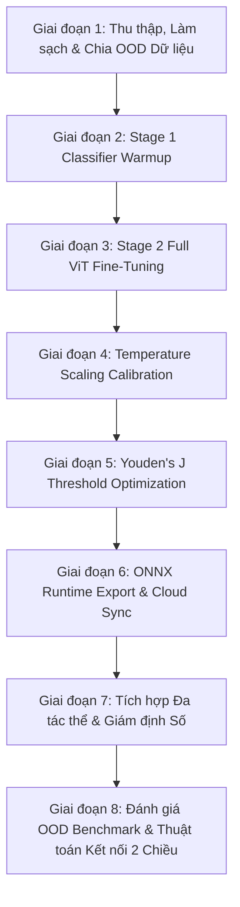

# ĐỀ CƯƠNG NGHIÊN CỨU XÉT TUYỂN NGHIÊN CỨU SINH (NCS) - VERSION 2

**Tên đề tài nghiên cứu**:  
**NGHIÊN CỨU PHÁT TRIỂN HỆ THỐNG ĐA TÁC THỂ PHÁT HIỆN ẢNH GIẢ MẠO (DEEPFAKE) DỰA TRÊN FINE-TUNING VISION TRANSFORMER VÀ HIỆU CHỈNH XÁC SUẤT BẰNG TEMPERATURE SCALING**

**Chuyên ngành**: Khoa học Máy tính / Hệ thống Thông tin  
**Mã số chuyên ngành**: 9480101  
**Họ và tên thí sinh**: [Họ và tên Nghiên cứu sinh]  
**Người hướng dẫn khoa học dự kiến**: [Họ và tên Giáo sư/Phó Giáo sư hướng dẫn]  
**Cơ sở đào tạo**: [Tên Trường Đại học / Viện Nghiên cứu]  
**Thời gian thực hiện dự kiến**: 2026 – 2029 (36 tháng)  

---

## I. TÊN ĐỀ TÀI NGHIÊN CỨU
**"Nghiên cứu phát triển hệ thống đa tác thể phát hiện ảnh giả mạo (Deepfake) dựa trên Fine-Tuning Vision Transformer và hiệu chỉnh xác suất bằng Temperature Scaling"**

---

## II. LÝ DO CHỌN ĐỀ TÀI (TÍNH CẤP THIẾT CỦA ĐỀ TÀI)

Trong những năm gần đây, sự bùng nổ của Trí tuệ Nhân tạo Sinh (Generative AI)—đặc biệt là các kiến trúc Mô hình Khuếch tán (Latent Diffusion Models - LDMs) như Stable Diffusion, Midjourney, Flux, và các kiến trúc Flow Matching Transformer (DiT)—đã cho phép tạo ra các hình ảnh giả mạo (Deepfake) với chất lượng chân thực ở mức kinh ngạc. Sự lan truyền của ảnh giả mạo đe dọa trực tiếp đến an ninh thông tin, tài chính, uy tín cá nhân và trật tự an toàn xã hội.

Tuy nhiên, các giải pháp phát hiện Deepfake hiện nay đang đối mặt với **3 thách thức kỹ thuật cốt lõi**:
1. **Suy giảm độ chính xác trên tập ngoài phân phối (Out-of-Distribution - OOD)**: Các mô hình phân loại tĩnh (static classifiers) khi huấn luyện trên các máy sinh ảnh thế hệ cũ (GANs) thường bị sụt giảm độ chính xác nghiêm trọng khi đối mặt với các máy sinh ảnh thế hệ mới chưa từng xuất hiện trong quá trình huấn luyện.
2. **Hiện tượng tự tin thái quá của mạng Nơ-ron (Probability Overconfidence)**: Các mô hình học sâu hiện đại thường gặp hiện tượng "lệch chuẩn xác suất" (uncalibrated probability), đưa ra mức độ tin tưởng tuyệt đối (>99%) ngay cả đối với các dự đoán sai ở vùng ranh giới quyết định.
3. **Thiếu tính minh bạch và khả năng giám định (Lack of Auditability)**: Các công cụ hiện tại chỉ trả về một chỉ số xác suất đơn lẻ mà không cung cấp giải thích bằng ngôn ngữ tự nhiên, không phân tích dấu vết tần số/không gian và không tạo ra chứng thư giám định đáp ứng các tiêu chuẩn pháp lý (như Đạo luật EU AI Act Điều 50 hay Đạo luật Dịch vụ Số DSA).

Để giải quyết triệt để các hạn chế trên, nghiên cứu này đề xuất một giải pháp toàn diện: **Kết hợp Fine-Tuning 2 giai đoạn trên mô hình Vision Transformer (`google/vit-base-patch16-224-in21k`), áp dụng kỹ thuật hiệu chỉnh xác suất Post-Hoc Temperature Scaling ($T^* = 1.6178$) cùng tối ưu ngưỡng Youden's J ($\tau^* = 0.8118$), và tích hợp vào Khung Hệ thống Đa tác thể (Multi-Agent System)** để phát hành Chứng thư Giám định Số có khả năng kiểm toán (Auditable Forensic Certificate).

---

## III. MỤC ĐÍCH VÀ NHIỆM VỤ NGHIÊN CỨU

### 1. Mục đích nghiên cứu
Xây dựng một hệ thống đa tác thể thông minh có khả năng phát hiện ảnh giả mạo Deepfake với độ chính xác cao trên tập ngoài phân phối (OOD), tự động hiệu chỉnh độ tin cậy xác suất và giải thích kết quả giám định bằng ngôn ngữ tự nhiên, tuân thủ các quy định pháp lý quốc tế về minh bạch AI.

### 2. Nhiệm vụ nghiên cứu
1. **Nghiên cứu quy trình làm sạch & phân tách dữ liệu OOD**: Đề xuất phương pháp lọc rác, khử trùng lặp kết hợp MD5 và Difference Hashing (`dhash`), và phân tách tập dữ liệu theo nguồn máy sinh (Source-Based OOD Split).
2. **Nghiên cứu kỹ thuật Fine-Tuning 2 giai đoạn cho Vision Transformer**: Xây dựng tiến trình huấn luyện 2 giai đoạn (Classifier Head Warmup + Full Model Fine-Tune với Cosine Annealing) trên mô hình nền `google/vit-base-patch16-224-in21k`.
3. **Nghiên cứu thuật toán hiệu chỉnh xác suất Post-Hoc**: Tối ưu hóa tham số nhiệt độ Temperature Scaling ($T^* = 1.6178$) để giảm chỉ số lỗi hiệu chỉnh (ECE) và xác định ngưỡng phân loại tối ưu Youden's J ($\tau^* = 0.8118$).
4. **Tối ưu hóa mô hình & Đẩy lên Cloud**: Xuất mô hình sang chuẩn ONNX Runtime (`custom_deepfake_vit.onnx`) và thiết lập luồng kết nối hai chiều (Bidirectional Bridge) giữa Local Agent và Cloud GPU (Google Colab).
5. **Phát triển Khung Hệ thống Đa tác thể (Multi-Agent System)**: Thiết kế Tác thể Điều phối (Orchestrator Agent), Tác thể Phát hiện (Detection Agent) và Tác thể Phân tích (Analysis Agent) tích hợp LLM Gemini để tạo Chứng thư Giám định Số Auditable Forensic Certificate.

---

## IV. ĐỐI TƯỢNG VÀ PHẠM VI NGHIÊN CỨU

- **Đối tượng nghiên cứu**:
  - Dữ liệu hình ảnh thật và ảnh giả mạo sinh ra từ các mô hình AI (GANs, Diffusion, DiT).
  - Kiến trúc mô hình Vision Transformer (ViT).
  - Thuật toán hiệu chỉnh xác suất Post-Hoc (Temperature Scaling, Youden's J Statistic).
  - Kiến trúc hệ thống Đa tác thể (Multi-Agent Orchestration & LLM Reasoning).
- **Phạm vi nghiên cứu**:
  - Loại dữ liệu: Ảnh tĩnh màu (RGB) độ phân giải từ $32 \times 32$ pixels trở lên.
  - Mô hình học máy: Kiến trúc `google/vit-base-patch16-224-in21k`.
  - Môi trường thử nghiệm: Local Antigravity IDE kết hợp Cloud GPU Google Colab (T4 / A100).

---

## V. TỔNG QUAN TÌNH HÌNH NGHIÊN CỨU

### 1. Tình hình nghiên cứu ngoài nước
- **Vision Transformer trong Giám định Hình ảnh**: Dosovitskiy et al. (2021) chứng minh ViT vượt trội CNN trong việc học phụ thuộc không gian toàn cục. Các nghiên cứu gần đây áp dụng ViT để phát hiện vi vết vết lưới (grid artifacts) trong ảnh tổng hợp.
- **Hiệu chỉnh Xác suất (Neural Network Calibration)**: Guo et al. (2017) chỉ ra các mạng nơ-ron hiện đại bị mất hiệu chỉnh nghiêm trọng và đề xuất Temperature Scaling như một phương pháp Post-Hoc đơn giản nhưng hiệu quả cao.
- **Hệ đa tác thể cho Giải thích AI (XAI)**: Các hệ đa tác thể dựa trên LLM (LangChain, AutoGen) cho phép chia nhỏ bài toán phức tạp thành các tác thể chuyên biệt, nâng cao tính minh bạch và khả năng tương tác.

### 2. Tình hình nghiên cứu trong nước
Tại Việt Nam, các nghiên cứu về phát hiện ảnh giả chủ yếu tập trung vào việc áp dụng các mạng CNN có sẵn (ResNet, EfficientNet) hoặc xử lý thủ công. Chưa có nghiên cứu nào kết hợp đồng thời: **Fine-Tuning ViT + Temperature Scaling + Tối ưu ngưỡng Youden's J + Kiến trúc Đa tác thể cấp Chứng thư Giám định Số**.

---

## VI. PHƯƠNG PHÁP NGHIÊN CỨU VÀ QUY TRÌNH 8 GIAI ĐOẠN

### 1. Phương pháp nghiên cứu lý thuyết
- Phân tích toán học của cơ chế Self-Attention trong Vision Transformer.
- Phân tích lý thuyết xác suất và hàm tối ưu Log-Likelihood trong Temperature Scaling:

$$\hat{p}_i = \frac{\exp(z_i / T)}{\sum_{j} \exp(z_j / T)}$$

- Nghiên cứu chỉ số Youden's J Statistic để xác định ngưỡng phân loại tối ưu:

$$J(\tau) = \text{Sensitivity}(\tau) + \text{Specificity}(\tau) - 1$$

### 2. Phương pháp nghiên cứu thực nghiệm
Thiết kế và cài đặt hệ thống phần mềm với quy trình 8 giai đoạn:
1. **Giai đoạn 1**: Lọc dữ liệu lỗi, khử trùng lặp bằng MD5 và `dhash`, chia tập dữ liệu OOD (Train: CIFAKE, GenImage, Deepfake_v1; Test OOD: New_Generators_Test).
2. **Giai đoạn 2 & 3**: Fine-tuning 2 giai đoạn trên backbone `google/vit-base-patch16-224-in21k` (Giai đoạn 1: 3 epochs Warmup head; Giai đoạn 2: 5 epochs Full fine-tune với Cosine Annealing).
3. **Giai đoạn 4 & 5**: Hiệu chỉnh nhiệt độ $T^* = 1.6178$ và tối ưu ngưỡng $\tau^* = 0.8118$.
4. **Giai đoạn 6**: Xuất mô hình sang ONNX (`custom_deepfake_vit.onnx`) và upload trọng số lên Hugging Face Hub (`ThangCao106/custom-deepfake-vit`).
5. **Giai đoạn 7**: Tích hợp Khung Đa tác thể phát hành Chứng thư Giám định Số Auditable Forensic Certificate.
6. **Giai đoạn 8**: Đánh giá Benchmark OOD và duy trì kết nối hai chiều (Bidirectional Bridge) giữa Local Agent và Google Colab qua API `/api/colab/callback`.

---

## VII. KẾ HOẠCH THỰC HIỆN NGHIÊN CỨU (DỰ KIẾN 36 THÁNG)

| Thời gian | Nội dung công việc | Sản phẩm dự kiến |
| :--- | :--- | :--- |
| **Năm 1** *(Tháng 1 - 12)* | - Nghiên cứu tổng quan lý thuyết ViT và Calibration. - Thu thập và làm sạch dữ liệu từ Hugging Face. - Xây dựng pipeline dữ liệu và bộ lọc trùng lặp `dhash`. | - Báo cáo tổng quan lý thuyết. - Bộ dữ liệu chuẩn hóa OOD. - 01 Bài báo Hội nghị Quốc gia/Quốc tế. |
| **Năm 2** *(Tháng 13 - 24)* | - Nghiên cứu thuật toán Fine-Tuning 2 giai đoạn. - Nghiên cứu Temperature Scaling và chỉ số Youden's J. - Thử nghiệm trên Cloud GPU Colab/Server. | - Trọng số mô hình ViT Fine-Tuned. - Bộ tham số hiệu chỉnh $T^*$ và $\tau^*$. - 01 Bài báo Scopus/ISI. |
| **Năm 3** *(Tháng 25 - 36)* | - Xây dựng Khung Hệ thống Đa tác thể (Multi-Agent System). - Tích hợp chứng thư giám định số và kết nối hai chiều API. - Đánh giá OOD Benchmark, đóng gói Docker và viết Luận án Tiến sĩ. | - Hệ thống phần mềm hoàn chỉnh. - 01 Bài báo Q1/Q2 ISI. - Luận án Tiến sĩ hoàn chỉnh. |

---

## VIII. KẾT QUẢ DỰ KIẾN ĐẠT ĐƯỢC VÀ ĐÓNG GÓP MỚI CỦA ĐỀ TÀI

### 1. Kết quả dự kiến
- **Bộ phần mềm**: Hệ thống web đa tác thể phát hiện Deepfake hoàn chỉnh đóng gói trong Docker.
- **Mô hình học máy**: Mô hình ViT fine-tuned `google/vit-base-patch16-224-in21k` kèm các tham số hiệu chỉnh nhiệt độ $T^* = 1.6178$ và ngưỡng $\tau^* = 0.8118$.
- **Công bố khoa học**: 02 - 03 bài báo khoa học đăng trên các tạp chí/hội nghị uy tín (Scopus/ISI).

### 2. Đóng góp mới của đề tài
1. **Đóng góp về mặt lý thuyết**: Đề xuất quy trình kết hợp Fine-Tuning ViT 2 giai đoạn với kỹ thuật hiệu chỉnh xác suất Post-Hoc Temperature Scaling, giúp giảm đáng kể chỉ số ECE và nâng cao khả năng tổng quát hóa trên các máy sinh ảnh chưa biết (OOD).
2. **Đóng góp về mặt công nghệ**: Xây dựng kiến trúc lai kết nối hai chiều (Bidirectional Bridge) giữa Local Agent và Cloud GPU, tự động hóa quy trình quét dataset từ Hugging Face và cập nhật mô hình trực tiếp.
3. **Đóng góp về mặt thực tiễn**: Thiết kế cấu trúc Chứng thư Giám định Số (Auditable Forensic Certificate) minh bạch, tiên phong đáp ứng các yêu cầu pháp lý của Đạo luật EU AI Act Điều 50 và DSA.

---

## IX. TÀI LIỆU THAM KHẢO

1. Dosovitskiy, A., et al. (2021). *An Image is Worth 16x16 Words: Transformers for Image Recognition at Scale*. International Conference on Learning Representations (ICLR).
2. Guo, C., Pleiss, G., Sun, Y., & Weinberger, K. Q. (2017). *On Calibration of Modern Neural Networks*. International Conference on Machine Learning (ICML), 1321-1330.
3. Youden, W. J. (1950). *Index for rating diagnostic tests*. Cancer, 3(1), 32-35.
4. European Parliament & Council. (2024). *Artificial Intelligence Act (EU AI Act) - Article 50 Transparency Obligations*.
5. Rombach, R., et al. (2022). *High-Resolution Image Synthesis with Latent Diffusion Models*. IEEE/CVF Conference on Computer Vision and Pattern Recognition (CVPR).
6. Bird, J. J., & Lotfi, A. (2024). *CIFAKE: Image Classification and Analysis of Fake Images Generated by AI*. IEEE Access.
