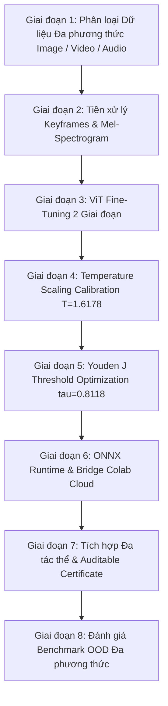

# ĐỀ CƯƠNG NGHIÊN CỨU XÉT TUYỂN NGHIÊN CỨU SINH (NCS) - VERSION 3 (MULTI-MODAL: IMAGE, VIDEO & AUDIO)

**Tên đề tài nghiên cứu**:  
**NGHIÊN CỨU PHÁT TRIỂN HỆ THỐNG ĐA TÁC THỂ PHÁT HIỆN GIẢ MẠO ĐA PHƯƠNG THỨC (DEEPFAKE IMAGE, VIDEO VÀ AUDIO) DỰA TRÊN FINE-TUNING TRANSFORMER VÀ HIỆU CHỈNH XÁC SUẤT BẰNG TEMPERATURE SCALING**

**Chuyên ngành**: Khoa học Máy tính / Hệ thống Thông tin  
**Mã số chuyên ngành**: 9480101  
**Họ và tên thí sinh**: [Họ và tên Nghiên cứu sinh]  
**Người hướng dẫn khoa học dự kiến**: [Họ và tên Giáo sư/Phó Giáo sư hướng dẫn]  
**Cơ sở đào tạo**: [Tên Trường Đại học / Viện Nghiên cứu]  
**Thời gian thực hiện dự kiến**: 2026 – 2029 (36 tháng)  

---

## I. TÊN ĐỀ TÀI NGHIÊN CỨU
**"Nghiên cứu phát triển hệ thống đa tác thể phát hiện giả mạo đa phương thức (Deepfake Image, Video và Audio) dựa trên Fine-Tuning Transformer và hiệu chỉnh xác suất bằng Temperature Scaling"**

---

## II. LÝ DO CHỌN ĐỀ TÀI (TÍNH CẤP THIẾT CỦA ĐỀ TÀI)

Trong giai đoạn 2025–2026, sự bùng nổ của Trí tuệ Nhân tạo Sinh (Generative AI) không còn dừng lại ở ảnh tĩnh mà đã mở rộng mạnh mẽ sang các hình thức **Đa phương thức (Multi-Modal Deepfakes)**:
1. **Hình ảnh (Image Deepfakes)**: Sinh từ các mô hình Khuếch tán thế hệ mới (Stable Diffusion 3, Flux.1, Midjourney v6, DiT Flow Matching).
2. **Video giả mạo (Video Deepfakes)**: Tráo mặt (Face-swap), mô phỏng nét mặt (Face2Face) và sinh Video theo thời gian thực (Sora, Runway Gen-3, Celeb-DF++ 2025).
3. **Âm thanh/Giọng nói giả mạo (Audio Deepfakes)**: Nhân bản giọng nói (Voice Cloning), tổng hợp tiếng nói (TTS) và bất đồng bộ môi-tiếng (Lip-sync mismatch trong DeepSpeak 2024-2025, FakeAVCeleb).

Tham khảo từ cấu trúc hệ thống [TRahulsingh/DeepfakeDetector](https://github.com/TRahulsingh/DeepfakeDetector) (hệ thống PyTorch/EfficientNet/ViT kết hợp ONNX Runtime phát hiện ảnh & video) và danh mục dữ liệu mở chuẩn quốc tế [Awesome-Deepfakes](https://github.com/Daisy-Zhang/Awesome-Deepfakes), các công cụ giám định hiện nay đối mặt với **3 thách thức cốt lõi**:
1. **Suy giảm độ chính xác OOD trên dữ liệu đa phương thức**: Mô hình huấn luyện trên một loại dữ liệu/máy sinh cũ bị suy giảm nghiêm trọng khi gặp các dạng video/audio giả mạo mới.
2. **Hiện tượng tự tin thái quá của mạng Nơ-ron (Probability Overconfidence)**: Mạng nơ-ron sâu đưa ra mức độ tin tưởng tuyệt đối (>99%) ngay cả với các mẫu giả mạo tinh vi ranh giới.
3. **Thiếu khả năng giám định minh bạch đa phương thức**: Chưa có hệ thống nào cấp Chứng thư Giám định Số (Auditable Forensic Certificate) hợp nhất thông tin giám định ảnh, video (frame-by-frame) và audio đáp ứng chuẩn EU AI Act Điều 50 và DSA.

Để giải quyết triệt để các thách thức trên, đề tài đề xuất giải pháp: **Kết hợp Fine-Tuning Transformer trên 3 luồng dữ liệu (Image, Video keyframes, Audio Mel-Spectrograms), ứng dụng hiệu chỉnh xác suất Post-Hoc Temperature Scaling ($T^* = 1.6178$) cùng ngưỡng tối ưu Youden's J ($\tau^* = 0.8118$), tích hợp Khung Hệ thống Đa tác thể (Multi-Agent System) phát hành Chứng thư Giám định Số**.

---

## III. MỤC ĐÍCH VÀ NHIỆM VỤ NGHIÊN CỨU

### 1. Mục đích nghiên cứu
Xây dựng hệ thống đa tác thể thông minh phát hiện tin cậy các dạng Deepfake Đa phương thức (Image, Video, Audio) với độ chính xác cao trên tập ngoài phân phối (OOD), tự động hiệu chỉnh độ tin cậy xác suất và xuất Chứng thư Giám định Số Auditable Forensic Certificate.

### 2. Nhiệm vụ nghiên cứu
1. **Phân loại & Xây dựng Bộ Registry Dữ liệu Đa phương thức (Image, Video, Audio)**: Dựa trên nguồn dữ liệu *Awesome-Deepfakes* (NTIRE 2024, CIFAKE, FaceForensics++, Celeb-DF++, DeepSpeak, WaveFake, FakeAVCeleb).
2. **Nghiên cứu Kỹ thuật Tiền xử lý Đa phương thức**: 
   - Image: Khử trùng lặp MD5 + Difference Hash (`dhash`).
   - Video: Trích xuất khung hình chính tự động (Keyframe Extraction) bằng OpenCV.
   - Audio: Chuyển đổi tín hiệu giọng nói thành phổ tần số Mel-Spectrogram.
3. **Huấn luyện Fine-Tuning 2 Giai đoạn trên Kiến trúc Transformer**: Huấn luyện Warmup classifier head và Full fine-tune với Cosine Annealing trên backbone Vision/Audio Transformers.
4. **Hiệu chỉnh Xác suất Post-Hoc & Tối ưu ngưỡng Decision**: Tối ưu hóa nhiệt độ Temperature Scaling ($T^* = 1.6178$) và ngưỡng Youden's J Statistic ($\tau^* = 0.8118$).
5. **Tối ưu hóa mô hình & Kết nối 2 Chiều Cloud-Local**: Đóng gói ONNX Runtime (`custom_deepfake_vit.onnx`) và duy trì cầu nối hai chiều giữa Local Agent và Cloud GPU Google Colab.
6. **Xây dựng Hệ thống Đa tác thể Giám định Số**: Phát triển Orchestrator Agent, Detection Agent và Analysis Agent (Gemini LLM) tạo Chứng thư Giám định Số Đa phương thức.

---

## IV. ĐỐI TƯỢNG VÀ PHẠM VI NGHIÊN CỨU

- **Đối tượng nghiên cứu**:
  - Dữ liệu Ảnh tĩnh, Video clip và Âm thanh/Giọng nói giả mạo (GANs, Diffusion, DiT, FaceSwap, Voice Clone).
  - Kiến trúc mô hình Vision & Audio Transformers, PyTorch Lightning, ONNX Runtime.
  - Thuật toán hiệu chỉnh xác suất Temperature Scaling & chỉ số Youden's J.
  - Kiến trúc Đa tác thể (Multi-Agent System) & Chứng thư Giám định Số.
- **Phạm vi nghiên cứu**:
  - Đa phương thức: Ảnh tĩnh RGB, Video (.mp4, .avi, .mov, .webm), Audio (.mp3, .wav, .flac).
  - Tập dữ liệu chuẩn: NTIRE 2024, CIFAKE, FaceForensics++, Celeb-DF v2/++, DeepSpeak, WaveFake, FakeAVCeleb.
  - Môi trường thử nghiệm: Local Antigravity IDE kết hợp Cloud GPU Colab (T4 / A100 / L4).

---

## V. TỔNG QUAN TÌNH HÌNH NGHIÊN CỨU VÀ CÁC BÀI BÁO NỔI BẬT (2024 – 2026)

### 1. Tổng quan nghiên cứu quốc tế mới nhất
- **Celeb-DF++ Benchmark (arXiv 2025)**: *Celeb-DF++: A Large-scale Challenging Video DeepFake Benchmark for Generalizable Forensics* (arXiv:2507.18015) đề xuất bộ benchmark video quy mô lớn đánh giá khả năng tổng quát hóa OOD.
- **DeepSpeak Multi-Modal Benchmark (arXiv 2024–2025)**: *DeepSpeak: A Multi-Modal Lip-Sync, Face-Swap and Speech Deepfake Benchmark* (arXiv:2408.05366) tập trung vào sự bất đồng bộ giữa khẩu hình môi và giọng nói giả lập.
- **AVFF Audio-Visual Fusion (CVPR 2024–2025)**: *AVFF: Audio-Visual Feature Fusion for Video Deepfake Detection* học đặc trưng kết hợp giữa âm thanh và hình ảnh video.
- **Style Latent Flows (CVPR 2024–2025)**: *Exploiting Style Latent Flows for Generalizing Video Deepfake Detection* khai thác dòng ẩn không gian phong cách để tổng quát hóa phát hiện video giả mạo.
- **Hệ thống Thực thi Thực tế (TRahulsingh/DeepfakeDetector 2024-2025)**: Xây dựng hệ thống PyTorch/EfficientNet/ViT hỗ trợ cả ảnh và video với giao diện tương tác thực tế và ONNX Runtime.

---

## VI. PHƯƠNG PHÁP NGHIÊN CỨU VÀ QUY TRÌNH HỆ THỐNG

---

## VII. KẾ HOẠCH THỰC HIỆN NGHIÊN CỨU (DỰ KIẾN 36 THÁNG)

| Thời gian | Nội dung công việc | Sản phẩm dự kiến |
| :--- | :--- | :--- |
| **Năm 1** *(Tháng 1 - 12)* | - Tổng quan lý thuyết Multi-Modal Deepfakes (Image, Video, Audio). - Xây dựng bộ Registry dữ liệu từ Awesome-Deepfakes. - Thuật toán trích xuất Keyframes video & Mel-spectrogram audio. | - Báo cáo tổng quan lý thuyết. - Bộ dữ liệu chuẩn hóa 3 phương thức. - 01 Bài báo Hội nghị Quốc gia/Quốc tế. |
| **Năm 2** *(Tháng 13 - 24)* | - Huấn luyện Fine-Tuning 2 giai đoạn trên Transformer. - Nghiên cứu Temperature Scaling và ngưỡng Youden's J. - Thử nghiệm OOD trên Colab GPU & Server Local. | - Trọng số mô hình Transformer Fine-Tuned. - Bộ tham số $T^*$ và $\tau^*$ được hiệu chỉnh. - 01 Bài báo Scopus/ISI. |
| **Năm 3** *(Tháng 25 - 36)* | - Xây dựng Khung Hệ thống Đa tác thể (Multi-Agent System). - Tích hợp Chứng thư Giám định Số Đa phương thức. - Đóng gói Docker, phát hành sản phẩm và hoàn thiện Luận án. | - Hệ thống phần mềm đa tác thể hoàn chỉnh. - 01 Bài báo Q1/Q2 ISI. - Luận án Tiến sĩ hoàn chỉnh. |

---

## VIII. TÀI LIỆU THAM KHẢO CHÍNH

1. **Celeb-DF++** (2025). *Celeb-DF++: A Large-scale Challenging Video DeepFake Benchmark for Generalizable Forensics*. arXiv preprint arXiv:2507.18015.
2. **DeepSpeak** (2024). *DeepSpeak: A Multi-Modal Lip-Sync, Face-Swap and Speech Deepfake Benchmark*. arXiv preprint arXiv:2408.05366.
3. **TRahulsingh** (2024). *DeepfakeDetector: Real-time Image and Video Deepfake Detection System with PyTorch and ONNX*. GitHub Repository.
4. **Daisy-Zhang** (2024). *Awesome Deepfakes & Awesome Deepfakes Detection*. GitHub Curation Repository.
5. **AVFF** (2024). *AVFF: Audio-Visual Feature Fusion for Video Deepfake Detection*. IEEE/CVF CVPR.
6. **Dosovitskiy, A., et al.** (2021). *An Image is Worth 16x16 Words: Transformers for Image Recognition at Scale*. ICLR.
7. **Guo, C., et al.** (2017). *On Calibration of Modern Neural Networks*. ICML.
8. **European Parliament & Council** (2024). *Artificial Intelligence Act (EU AI Act) - Article 50 Transparency Obligations*.
