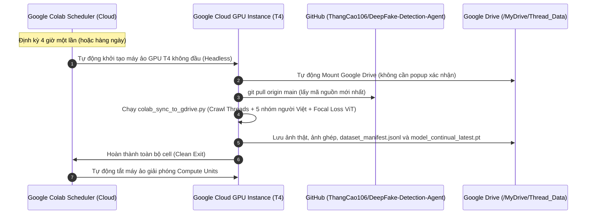

# Hướng Dẫn Cấu Hình Google Colab Pro Tự Động Chạy (Scheduled Runs 100% Headless)

Tài liệu này hướng dẫn chi tiết cách thiết lập **Google Colab Pro Scheduled Runs** để tự động thu thập dữ liệu Threads, đóng gói bộ dữ liệu 5 nhóm khuôn mặt người Việt, trích xuất đặc trưng sinh trắc học và huấn luyện tăng cường mô hình ViT với Focal Loss hoàn toàn tự động trên máy chủ Google Cloud mà **không cần mở máy tính hay trình duyệt**.

---

## 📌 1. Cơ Chế Hoạt Động Của Colab Pro Scheduled Runs

---

## 🛠️ 2. Các Bước Thiết Lập 100% Tự Động Trong 2 Phút

### Bước 1: Mở Notebook Trên Google Colab
1. Truy cập [Google Colab](https://colab.research.google.com/).
2. Chọn tab **GitHub** $\to$ Nhập đường dẫn:
   `https://github.com/ThangCao106/DeepFake-Detection-Agent`
3. Chọn tệp: `colab_training/Colab_Pro_Scheduled_Runner.ipynb`.

### Bước 2: Lưu Sổ Tay Vào Google Drive Của Bạn
- Vào menu: **File (Tệp)** $\to$ **Save a copy in Drive (Lưu một bản sao trong Drive)**.
- Đặt tên tệp: `Colab_Pro_Scheduled_Runner.ipynb` nằm trong thư mục gốc của Google Drive hoặc thư mục mong muốn.
*(Lưu ý bắt buộc: Scheduled Runs chỉ hỗ trợ các notebook được lưu trực tiếp trên Google Drive).*

### Bước 3: Cấu Hình GPU Cho Notebook
- Vào menu: **Runtime (Thời gian chạy)** $\to$ **Change runtime type (Thay đổi loại thời gian chạy)**.
- Chọn **T4 GPU** $\to$ Bấm **Save (Lưu)**.

### Bước 4: Thiết Lập Lịch Chạy Tự Động (Scheduled Runs)
1. Ở thanh công cụ bên trái giao diện Colab, bấm vào biểu tượng **Đồng hồ hẹn giờ (Scheduled runs)** (hoặc vào menu **Edit $\to$ Notebook settings $\to$ Scheduled runs**).
2. Bấm vào nút **"Add schedule" (Thêm lịch trình)**.
3. Cấu hình các thông số:
   - **Frequency (Tần suất)**: Chọn `Hourly` (sau mỗi X giờ, ví dụ: 4 hours) hoặc `Daily` (hàng ngày vào giờ cố định).
   - **Hardware accelerator (Bộ tăng tốc phần cứng)**: Chọn `T4 GPU`.
   - **Tích chọn "Auto-mount Google Drive"**: Google sẽ tự động cấp quyền truy cập vào Drive ngầm định mà không hỏi cửa sổ xác thực.
4. Bấm **Save (Lưu)**.

---

## 📊 3. Kiểm Tra Kết Quả & Nhật Ký Thực Thi

Sau mỗi chu kỳ chạy, bạn có thể kiểm tra:
1. **Lịch sử thực thi (Run History)**:
   - Bấm vào biểu tượng Đồng hồ hẹn giờ $\to$ Tab **History**: Xem trạng thái `Succeeded`, thời gian chạy (khoảng 3–5 phút) và log đầu ra từng cell.
2. **Dữ liệu trên Google Drive**:
   - Truy cập Google Drive: thư mục `Thread_Data/YYYY-MM-DD/`:
     - `01_raw_originals/`: Chân dung thật người Việt (5 nhóm).
     - `02_manipulated_faceswap/`: Biến thể ghép mặt đối chứng.
     - `03_manipulated_openweight/`: Biến thể sinh bởi AI khuếch tán.
     - `dataset_manifest.jsonl`: Manifest học thuật có nhãn 5 nhóm và chỉ số sinh trắc học $E_{high}, Z_{peak}$.
     - `hard_samples_manifest.jsonl`: Tập mẫu biên có độ hỗn loạn Shannon $H(P) \ge 0.70$.
     - `dataset_summary.md`: Báo cáo định lượng phân bố mẫu.
     - `checkpoints/model_continual_latest.pt`: Trọng số mô hình ViT đã được fine-tune tăng cường.

---

## 💡 4. Những Lưu Ý Quan Trọng Để Tiết Kiệm Compute Units

1. **Không dùng cờ `--loop` trong Scheduled Runs**:
   - Tệp notebook `Colab_Pro_Scheduled_Runner.ipynb` được thiết kế chạy **đúng 1 lượt (Single Batch Pass)** rồi kết thúc.
   - Khi notebook chạy xong cell cuối cùng, Google Cloud sẽ tự động tắt máy ảo, giúp bạn chỉ tiêu tốn khoảng **0.1 – 0.2 Compute Units** cho mỗi lần chạy 4 tiếng, không bao giờ bị lãng phí tài nguyên.
2. **Theo dõi Hạn mức Compute Units**:
   - Gói Colab Pro cung cấp 100 Compute Units/tháng, hoàn toàn đủ cho bạn chạy tự động 4-6 lần/ngày trong suốt tháng nghiên cứu.
