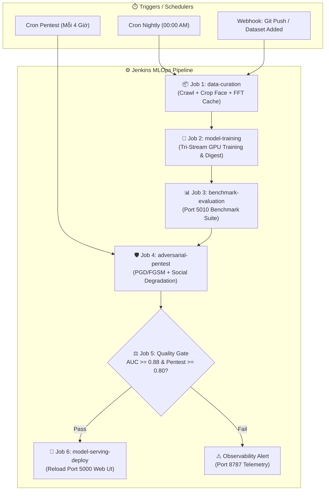

# 🚀 Automated MLOps Continuous Pipeline với Jenkins (Nghiên cứu NCS - Option B)

Tài liệu này chi tiết hóa toàn bộ hệ thống tự động hóa **Continuous MLOps Pipeline** bằng **Jenkins**, phục vụ phương hướng nghiên cứu chuyên sâu (Option B - 6 Tuần PhD Research Standard). Hệ thống liên kết chặt chẽ giữa máy chủ đào tạo, hệ thống Benchmark Hub (Port 5010), Pentest Runner và Web Serving UI (Port 5000).

---

## 📅 1. Bảng Phân Bổ Thời Gian (Time-Range Schedule) Theo Option B (6 Tuần)

| Giai đoạn | Tuần | Mục tiêu nghiên cứu (Ph.D. Milestones) | Các Jenkins Job vận hành tự động |
| :--- | :---: | :--- | :--- |
| **Phase 1: Data Preparation** | **Tuần 1 - 2** | • Chuẩn hóa 3 tập dataset lớn: FaceForensics++ (c23, c40), Celeb-DF v2, WildDeepfake. • Face ROI alignment (256x256), bóc tách tần số 2D-FFT/DCT. • Phân chia K-Fold độc lập danh tính (Identity-aware split). | • `deepfake-01-data-curation` Chạy hàng đêm (00:00 UTC) tự động crawl OOD Threads samples, validate dữ liệu, sinh cache ảnh & phổ tần số. |
| **Phase 2: Model Training** | **Tuần 3 - 4** | • Huấn luyện Tri-Stream Architecture (Spatial Backbone + Frequency Stream + Temporal Consistency). • Tối ưu Cross-Attention Fusion. • Lưu checkpoint lũy tiến theo từng epoch lên server/GDrive. | • `deepfake-02-model-training` Lập lịch kích hoạt tự động theo batch dữ liệu, theo dõi loss/convergence và xuất Training Digest. |
| **Phase 3: Model Evaluation** | **Tuần 5** | • Đánh giá In-Domain & Cross-Dataset (Train trên FF++ ➔ Test trên Celeb-DF, DFDC). • Thực hiện Ablation Studies (So sánh Spatial-only vs Frequency-only vs Tri-Stream). • Tính toán AUC-ROC, EER, F1-Score, Brier Score, Inference Latency. | • `deepfake-03-benchmark-evaluation` Gọi trực tiếp lõi `eval_benchmark.py` (tương đương Port 5010), trích xuất ma trận nhầm lẫn và biểu đồ ROC. |
| **Phase 4: Pentest & Hardening** | **Tuần 6** | • Tấn công đối kháng White-box (FGSM, PGD $L_\infty$, Carlini-Wagner). • Tấn công Black-box: Nén video xã hội (H.264/H.265 bit-rate drop, Gaussian blur, resizing). • Adversarial Retraining để gia cố mô hình. | • `deepfake-04-adversarial-pentest` Chạy định kỳ (4 tiếng/lần hoặc hậu train), ghi log vào SQLite `deepfake_agent_memory.db` và xuất Pentest Scorecard. |

---

## 🏗️ 2. Kiến Trúc 5 Micro-Jobs Trên Jenkins

Để đảm bảo tính module hóa và dễ debug, bạn có thể triển khai thành 5 Jenkins Jobs độc lập liên kết theo mô hình **Pipeline Triggers** (Downstream Jobs), hoặc chạy gộp qua file gốc [`Jenkinsfile`](file:///d:/DATA/TC/Py_Ex/NCS/DeepFake-Detection-Agent/Jenkinsfile).

---

### Job 1: `deepfake-01-data-curation`
* **Trigger / Cron**: `H 0 * * *` (00:00 hàng ngày) hoặc Webhook khi có file dataset mới.
* **Thời gian chạy ước tính**: 30 - 45 phút.
* **Nhiệm vụ chính**:
  1. Kiểm tra tính toàn vẹn file ảnh/video trong `colab_datasets/`.
  2. Dùng RetinaFace / MTCNN để crop khuôn mặt 256x256, loại bỏ frame mờ (Laplacian variance < 100).
  3. Tính toán trước ma trận tần số 2D-FFT và lưu dạng cache nhị phân (.npy / .pt) để tăng tốc 5x khi train.
  4. Phân chia Train/Val/Test theo nguyên tắc **Identity-Separated** (không để 1 diễn viên xuất hiện ở cả train và test).
* **Output Artifacts**: Metadata manifest `processed_manifest.json`, dataset digest.

---

### Job 2: `deepfake-02-model-training`
* **Trigger**: Tự động kích hoạt khi `Job 1` hoàn tất thành công (Build after other projects are built).
* **Thời gian chạy ước tính**: 2 - 4 giờ (tùy số epoch và GPU).
* **Parameters**:
  * `MODEL_TYPE`: `general`, `human`, hoặc `tri_stream`
  * `EPOCHS`: 20 (mặc định)
  * `LEARNING_RATE`: 0.0001 với Cosine Annealing scheduler
* **Nhiệm vụ chính**:
  1. Kích hoạt môi trường PyTorch CUDA trên Agent GPU.
  2. Nạp dữ liệu từ cache của Job 1.
  3. Thực hiện training phân nhánh: Spatial Stream (ConvNeXt/EffNet) + Frequency Stream (F3-Net).
  4. Lưu model checkpoint tốt nhất dựa trên Validation Loss (`best_checkpoint.pth`).
  5. Sinh báo cáo tóm tắt quá trình hội tụ qua `scripts/generate_training_digest.py`.
* **Output Artifacts**: `checkpoints/best_checkpoint.pth`, `training_digest.json`.

---

### Job 3: `deepfake-03-benchmark-evaluation`
* **Trigger**: Tự động kích hoạt sau `Job 2`.
* **Thời gian chạy ước tính**: 15 - 20 phút.
* **Nhiệm vụ chính**:
  1. Nạp `best_checkpoint.pth` vừa được sinh ra.
  2. Chạy bộ đánh giá chuẩn hóa qua engine Benchmark (tương thích Benchmark Hub Port 5010):
     * **In-domain testing**: Test trên test-set cùng nguồn.
     * **Cross-dataset testing**: Train trên FaceForensics++ ➔ Test trên Celeb-DF v2.
  3. Tính toán các chỉ số: **AUC-ROC**, **EER (%)**, **F1-Score**, **FPR @ 95% TPR**, **Average Latency (ms)**.
* **Output Artifacts**: `report_colab/benchmark/latest_benchmark_summary.json`, biểu đồ ROC curve `.png`.

---

### Job 4: `deepfake-04-adversarial-pentest`
* **Trigger**: Chạy nối tiếp `Job 3` HOẶC chạy độc lập định kỳ 4 tiếng/lần (`0 */4 * * *`) để kiểm tra dữ liệu mạng xã hội mới crawl.
* **Thời gian chạy ước tính**: 20 - 30 phút.
* **Nhiệm vụ chính (Pentest Suite)**:
  1. **White-box Adversarial Attack**: Bắn nhiễu PGD ($L_\infty$, $\epsilon = 8/255$, 10 steps) và FGSM.
  2. **Social Media Codec Degradation**: Giả lập tái mã hóa video (H.264 CRF 28, H.265, Resize 50%, Motion Blur).
  3. **Real-world OOD Testing**: Đánh giá trên 1,000 bài đăng mới nhất từ Threads crawler.
  4. Cập nhật lịch sử kiểm thử vào SQLite database `report_colab/deepfake_agent_memory.db`.
* **Output Artifacts**: `report_colab/pentest/pentest_report_*.md`, SQLite DB updates.

---

### Job 5: `deepfake-05-model-promotion-serving`
* **Trigger**: Tự động kích hoạt sau `Job 4`.
* **Điều kiện tiên quyết (Quality Gate)**:
  * `AUC >= 0.88`
  * `EER <= 12%`
  * `Pentest Robustness Score >= 0.80` (suy giảm AUC dưới tấn công không vượt quá 10%)
* **Nhiệm vụ chính**:
  1. Nếu đạt Quality Gate:
     * Cập nhật symlink trọng số sản xuất: `weights/production_model.pth`.
     * Tự động reload container Web UI cổng 5000 (`docker restart deepfake-web-ui`).
     * Gửi webhook thông báo tới Observability Agent (Port 8787).
  2. Nếu không đạt:
     * Giữ nguyên phiên bản model đang phục vụ trên Port 5000.
     * Đánh dấu Build trạng thái **UNSTABLE**, gửi email/slack alert cảnh báo hiện tượng Overfitting hoặc Model Degradation.

---

## 🛠️ 3. Hướng Dẫn Import Vào Jenkins Server

### Cách 1: Sử dụng File Pipeline Duy Nhất (`Jenkinsfile`)
1. Trong giao diện Jenkins: Chọn **New Item** ➔ Đặt tên `DeepFake-MLOps-Pipeline` ➔ Chọn loại **Pipeline**.
2. Ở mục **Build Triggers**: Tích chọn **Build periodically**, điền `H 1 * * 1-5`.
3. Ở mục **Pipeline**:
   * Chọn **Pipeline script from SCM**.
   * SCM: **Git**.
   * Repository URL: `https://github.com/ThangCao106/DeepFake-Detection-Agent.git`.
   * Branch Specifier: `*/main`.
   * Script Path: `Jenkinsfile`.
4. Nhấn **Save** và nhấn **Build with Parameters** để chạy thử.

### Cách 2: Chạy Từng Job Riêng Biệt (Jenkins Multibranch / Upstream-Downstream)
Nếu bạn cấu hình 5 jobs riêng, vào phần cấu hình của từng job:
* Tại **Post-build Actions** của Job 1: Chọn *Build other projects* ➔ Điền `deepfake-02-model-training`.
* Tại **Post-build Actions** của Job 2: Chọn *Build other projects* ➔ Điền `deepfake-03-benchmark-evaluation`.
* Tương tự cho các job tiếp theo.
