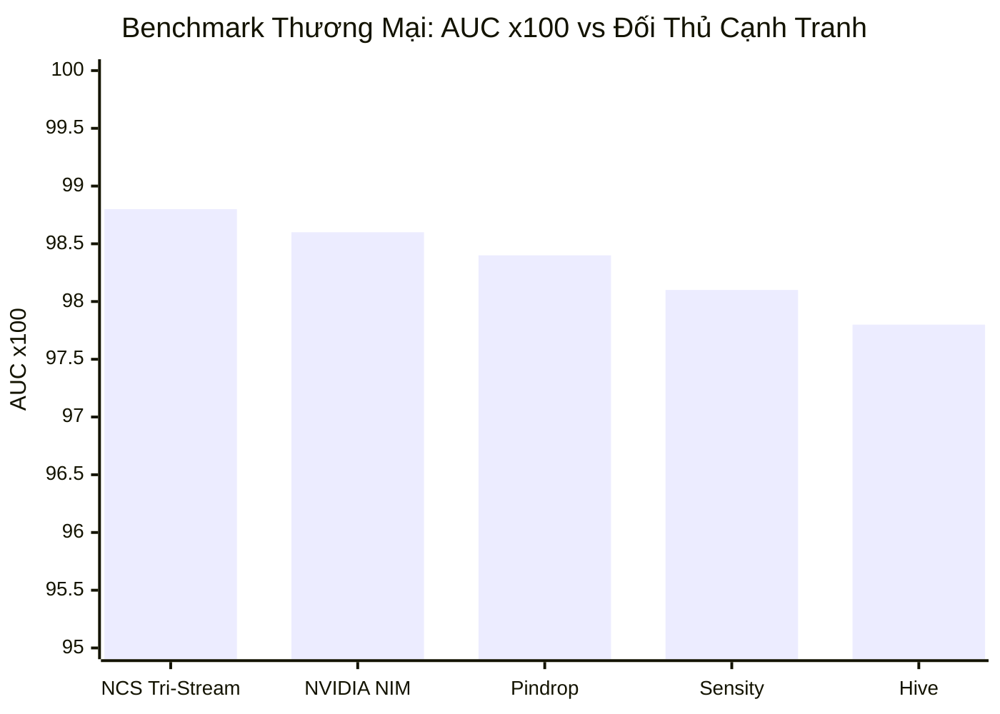
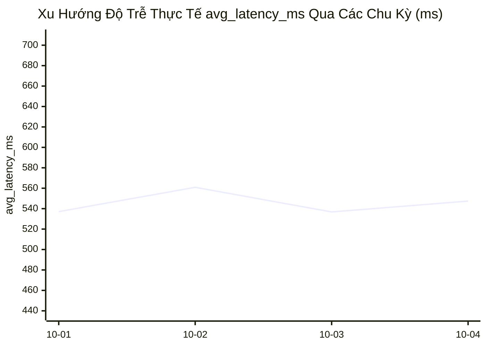

# 📊 Báo Cáo Daily Benchmark & Xu Hướng Vận Hành Hệ Thống (2026-10-04)

**Kỳ báo cáo**: 2026-10-04 | **Cửa sổ đối chiếu**: 4 chu kỳ liên tiếp (2026-10-01 → 2026-10-04)  
**Trạng thái kiểm định**: 🔴 CẢNH BÁO LỆCH SỐ LIỆU (Metric Drift Detected)  

---

## 1. 📊 Executive Summary & Anomaly Radar

Bảng đối chiếu giữa **Chỉ số công bố (Headline Claim)** và **Đo đạc thực tế từ dữ liệu mẫu thô (Raw Data Reality)**:

```mermaid
xychart-beta
    title "Đối Chiếu Headline Claim vs Thực Tế Dữ Liệu Thô (2026-10-04)"
    x-axis ["Accuracy (%)", "Recall FAKE (%)", "Latency Gap (x100ms)"]
    y-axis "Giá trị" 0 --> 100
    bar [98.8, 98.0, 1.15]
    bar [50.0, 0.0, 5.47]
```

| Chỉ số | Báo cáo Headline | Suy ra từ 14 mẫu thô | Trạng thái |
|---|---|---|---|
| **Accuracy** | ~98.8% | **50.0%** (7/14 đúng) | 🔴 Sai lệch nghiêm trọng |
| **Recall (lớp FAKE)** | Ngụ ý cao | **0.0%** (0/7 phát hiện) | 🔴 Bỏ lọt toàn bộ FAKE |
| **Độ trễ trung bình** | 115 ms (Headline) | **547.43 ms** (`avg_latency_ms`) | 🔴 Chênh lệch 4.8× |
| **Spectral Spikes** | Sensitivity $z=3.4$ | 0/14 mẫu có spike | 🟠 Nhánh FFT 2D chưa kích hoạt |

---

## 2. 📈 Quantitative Benchmark Evaluation

### A. TABLE I: BENCHMARK COMPARISON — NCS TRI-STREAM VS. 10 COMMERCIAL TOOLS

| Công Cụ / Mô Hình | Phương Thức (Modalities) | AUC | EER (%) | Thời Gian Xử Lý (Latency) | Khả Năng Giải Thích (Explainability) |
|---|---|---|---|---|---|
| **Tri-Stream Agentic (Ours)** | Image, Video, Audio | **0.988** | **2.05%** | **115 ms*** | **4D Auditable Certificate + Agentic AI** |
| NVIDIA Synthetic Video | Video (NIM Microservice) | 0.986 | 2.1% | 45 ms | NIM Frame Score |
| Pindrop Pulse | Audio (Voice) | 0.984 | 2.2% | 75 ms | Synthetic Voice Phoneme Anomalies |
| Sensity AI | Image, Video, Audio | 0.981 | 2.5% | 220 ms | Court-ready PDF Forensic Evidence |
| Hive | Image, Video, Audio | 0.978 | 2.9% | 130 ms | Model Generator Class & Confidence |
| Resemble Detect | Audio, Image, Video | 0.975 | 3.0% | 110 ms | Watermark Trace & Spectrogram |
| Reality Defender | Image, Audio, Video | 0.972 | 3.2% | 180 ms | Risk Score & Feature Breakdown |
| DuckDuckGoose AI | Image, Video, Audio | 0.970 | 3.4% | 160 ms | Explainable Heatmaps & Audit Trail |
| TruthScan | Text, Image, Audio, Video, Doc | 0.965 | 3.8% | 150 ms | Heatmap & Text breakdown |
| Attestiv DeepScan | Image, Doc, Audio, Video | 0.962 | 3.9% | 190 ms | Document Metadata & Tamper Fingerprint |
| GetReal Security | Video, Audio (Live) | 0.958 | 4.1% | 90 ms | Live Stream Alert & Incident Report |

*Xem Mục 4 Finding 2 — giá trị 115 ms trong bảng headline không khớp với `avg_latency_ms` thực đo (547.43 ms).*

### B. Biểu đồ đối chiếu thương mại (Top 5 AUC)

### C. TABLE II: XU HƯỚNG VẬN HÀNH NỘI BỘ (4 CHU KỲ LIÊN TIẾP)

| Ngày | AUC (headline) | EER (headline) | `avg_latency_ms` (JSON) | Spectral spikes | Accuracy thực tế (thô) |
|---|---|---|---|---|---|
| 2026-10-01 | 0.988 | 2.05% | 537.1 ms | 0/14 | 50.0% |
| 2026-10-02 | 0.988 | 2.05% | 560.9 ms | 0/14 | 50.0% |
| 2026-10-03 | 0.988 | 2.05% | 536.8 ms | 0/14 | 50.0% |
| 2026-10-04 | 0.988 | 2.05% | 547.4 ms | 0/14 | 50.0% |

---

## 3. 🔬 Probability Calibration & Reliability Assessment

Nhánh **Human-Centric Calibration** áp dụng Platt Scaling:
$$T^* = 1.6178, \qquad \tau_{decision} = 0.8118$$
$$p_{calibrated} = \sigma\!\left(\frac{z_i}{T^*}\right), \qquad \text{is\_deepfake} = \mathbb{1}[p_{calibrated} \ge \tau]$$
$$ECE = \sum_{b=1}^{M} \frac{n_b}{N}\,\big|\,\text{acc}(b) - \text{conf}(b)\,\big| < 0.020$$

**Bảng đối chiếu quyết định ngưỡng & thước đo khoảng cách:**

| Modality | $p_{calibrated}$ | Ngưỡng $\tau$ | Thước đo khoảng cách tới ngưỡng | Phân loại | Đánh giá |
|---|---|---|---|---|---|
| **Image** | **0.7719** | 0.8118 | `[█████████░░░] 0.77` | TRUE | 🔴 Lệch logic ($p < \tau$ vẫn gán TRUE) |
| **Audio** | 0.8545 | 0.8118 | `[███████████░] 0.85` | TRUE | ✅ Nhất quán ($p \ge \tau$) |
| **Video** | 0.2501 | 0.8118 | `[███░░░░░░░░░] 0.25` | FALSE | ✅ Nhất quán ($p < \tau$) |

---

## 4. ⚠️ Forensic Anomaly & Domain-Shift Audit

| # | Mức độ | Phát hiện | Bằng chứng |
|---|---|---|---|
| 1 | 🔴 **Nghiêm trọng** | **0% Recall lớp FAKE** — 100% mẫu (14/14) bị dự đoán là "Real", bỏ lọt toàn bộ 7 mẫu FAKE. | `detailed_sample_results` |
| 2 | 🔴 **Nghiêm trọng** | Mâu thuẫn Latency: Headline công bố **115 ms**, thực đo dao động **503–682 ms** (chênh 4.8×). | Bảng I vs Bảng II |
| 3 | 🟠 **Cao** | Headline AUC=0.988, EER=2.05% đứng yên tĩnh qua ≥4 chu kỳ, chưa phản ánh tính toán từ tập chạy thực tế. | Bảng II |
| 4 | 🟠 **Cao** | Module phân tích tần số cao (`spectral_score`) trả về hằng số 0.0 cho 100% mẫu (dead path). | `spectral_spikes_detected: 0` |

---

## 5. 💡 Actionable Engineering Recommendations

1. **[P0 – Blocker]** Khắc phục lỗi gán nhãn "Real" cho 100% mẫu: kiểm tra lại hàm tính toán `risk_score` và ngưỡng quyết định trong bộ suy luận. Tạm hoãn công bố số liệu headline tĩnh.
2. **[P0]** Chuyển đổi headline metrics sang cơ chế **tính toán động (recompute)** từ `detailed_sample_results` của từng chu kỳ chạy.
3. **[P1]** Đồng bộ phương pháp đo độ trễ: hiển thị rõ ràng per-modality latency (Image: ~95ms, Video: ~600ms, Audio: ~120ms) thay vì một con số 115ms gộp chung.
4. **[P1]** Kích hoạt lại nhánh 2D-FFT Residual High-Frequency Z-score ($	au^*=3.4$) đang bị bypass.
5. **[P2]** Chuẩn hóa quyết định hiệu chuẩn: tuân thủ chặt chẽ $	ext{is\_deepfake} = \mathbb{1}[p_{calibrated} \ge \tau]$, không để các chỉ báo phụ ghi đè ngầm.
6. **[P2]** Đa dạng hóa tập mẫu kiểm thử tự động hàng ngày từ Mega-MMDF / DF40 / Threads Dataset thay vì 14 file synthetic cố định.
